# 25 · LuGus Studios — "Fly on Venus": VESPER, a solar-electric rotorcraft for the cloud deck

Prepared 4 Nov 2026 for the Friday 6-hour LuGus slot (EUROAVIA Ideathon 2026, 5–6 Nov). Brief: the handwritten notes
in `00_Common/organiser_notes/04_LuGus_Venus_Rotorcraft.md` (a transcription, **not** the official text):
*"Design a rotorcraft that can fly on Venus"* — (1) where should it fly (T, p, ρ, wind), (2) rotors, propulsion,
material, power, thermal, what does it look like, (3) how does it get there; deliverables: visual design with main
components, altitude justified with atmospheric data, propulsion/power/thermal/control/comms, feasibility, risks,
open challenges.

**Tags** (user rule, `docs/21`): **[D]** read from the primary source by this session · **[D-ag]** read by a research
agent (notes in `04_Venus/research/`, one file per source; index `README.md`) · **[K]** computed here ·
**[Y]** our judgement/assumption. Every [K] number comes from `python 04_Venus/scripts/venus_day.py --final`
(`04_Venus/outputs/result.json`) unless another command is named.

**Friday morning checklist** (state on 4 Nov, 23:15; details in §9–§11):
1. `python 04_Venus/scripts/venus_day.py --final` (~5 min tonight): it must end with "15 figures + set consistency, 0 errors".
2. Venus tests: `python -m pytest -q -p no:cacheprovider tests/test_venus_*.py tests/test_planetary.py tests/typing`.
3. Ask the mentor first: is a pure rotorcraft required, or is the helium hybrid (§8) allowed? Their payload/altitude → `--payload-kg … --cruise-km …` (§11).
4. The pitch in four numbers: 43.7 kg, hover 2.1 kW / loiter 1.34 kW at 55 km, ~49 h of flight, 56 g entry.
5. Say the limits out loud: no night (1.04 vs ~103 kWh), no station keeping (24–119 kW), no landing (§6.3).
6. Visual: `design.json` v0.6 (final, 13 components = 43.65 kg) → venus-visual session; F1–F15 for the slides.
7. Simulator: give LuGus `sim_params.json` + `sim_params_README.md`; scenarios in §6.1.
8. Evidence: tags [D]/[D-ag]/[K]/[Y]; random audit 15/15 sourced, fixes applied (`R_audit_2026-11-04.md`).
9. Cross-checks (§7.1): power −20…+11 %, mass explained (vessel + arms), sun threshold exact, flight time −5 %.
10. Known soft spots (§7.2): bifacial deck (one-sided cells → 27 h window), spin-up needs −16° collective, motor-out yaw untested, BEMT factor 1.05 unmeasured.

> **Özet (TR).** VESPER, 55 km'de (26 °C, 0,51 bar, ρ 0,89 kg/m³ — Pioneer Venus sondalarının ham verisinden)
> süper rotasyonla birlikte sürüklenerek uçan, **6 × 2,6 m rotorlu, 5:1 dişli motorlu, katlanır, 43,7 kg'lık
> güneş-elektrikli bir heksakopter**. Rotorlar BEMT ile tasarlandı ve iki NACA test veri setine karşı doğrulandı
> (tork, 27 nokta, rms %6). Hover 2,1 kW, en ekonomik ileri uçuş (7,8 m/s) 1,3 kW; 4,45 m²'lik çift yüzlü güneş
> güvertesi tepedeki güneşte 3,0 kW veriyor → güneş zenitten ~53° içindeyken **güneşle süresiz uçar**. Görev: hava
> kütlesinde bir gündüz boyunca **~49 saat uçuş (44 saati güneşle)**, 51 km'ye bilim dalışları, gün batımında 47 km'ye
> son dalış. Venüs'e 3,7 m'lik düşük-β (25 kg/m²) bir giriş kapsülüyle −9,5°'de giriyor (tepe 56 g; Pioneer Venus
> 280 g), 79 km'de paraşüt, rotorlar paraşüt altında asılıyken dönmeye başlıyor, 61 km'de bırakılıyor (26 m irtifa
> kaybı; dönmeden bırakılsa 559 m). Saf rotorcraft **geceyi (~3 Dünya günü) geçiremez** — bu dürüstçe söyleniyor;
> geceyi geçen helyum-hücreli hibrit (5,7 m küre) yalnız mentor onayıyla alternatif. Dişli tahrik, doğrudan
> tahrikte "kapanmayan" (kütlesi ıraksayan) kötü senaryoları kapatıyor: her olumsuz varsayımda ≥ 43,8 saat uçuş.
> Giriş modeli 12 tarihî Venüs girişinde (Venera 4–14, Vega, Pioneer Venus) tepe yavaşlamayı %3,5 rms hatayla
> veriyor. Açılma Monte Carlo'su (ölçülmüş rüzgâr profilleri): ileri uçuşla toparlanmada p99 irtifa kaybı 41 m.
> **Yüzeye inmiyor**: gün batımı dalışından sonra dönen rotorlarla ~12 saatte düşer, elektronik ~34 km'de 125 °C'yi
> aşar; yüzeye soğuk konsa bile ~26 dakikada ölür (Venera 13: 127 dk, ~750 kg iniş aracı).

## 1. The answer in one paragraph [K unless tagged]

**VESPER** (*Venus Solar-Electric Powered Exploration Rotorcraft* [Y]) is a 43.7 kg folding hexacopter with six
2.6 m two-blade rotors at 514 rpm (tip Mach 0.26, Reynolds 1.7×10⁵) driven through sealed 5:1 planetary gearboxes, a
4.45 m² bifacial solar deck, a 1.04 kWh Li-ion battery and a sealed titanium vessel. It flies at **55 km** in the
air-mass frame, drifting west with the 65 m/s super-rotation; at its 7.8 m/s minimum-power airspeed it needs 1.34 kW,
which the array supplies whenever the Sun is within ~53° of the zenith (an overhead Sun even covers hover). Delivered
by a 3.7 m, 284 kg entry capsule (β 25 kg/m², −9.5°, 56 g peak), it is spun up under the parachute, released at 61 km,
and flies **~49 h** (44 h on sunlight, 11 500 km of drift) through one air-mass day, ending in a sunset dive below the
middle cloud. It cannot survive the ~3-Earth-day night — the honest limit of a pure rotorcraft on Venus; a
helium-assisted variant that can is offered as an alternative needing mentor approval (§8).

## 2. What was verified, by whom

| Item | How | Tag |
|---|---|---|
| CO₂ Cp (Shomate), viscosity, conductivity, speed of sound 225–400 K | NIST WebBook pages fetched by this session (`K_nist_co2_properties.md`) | D |
| GM of Venus and Sun | JPL SSD astrodynamic-parameters page fetched by this session | D |
| Pioneer Venus T, p, ρ (4 probes), DLBI winds, LSFR solar flux | raw PDS4 tables (downloaded by agent A) **extracted by this session** with `04_Venus/scripts/venus_pds_extract.py` → `src/aerokit/venus/data/pv_profiles.json`; reproduces agent A's table to the last digit | D |
| VIRA (Seiff et al. 1985) tables | **not obtained** (ADS 403/CAPTCHA, NTRS none); agent A used a Venus-GRAM copy (tertiary); the Wikipedia/VIRA-like table is kept only outside 40–64 km | — |
| Sutton–Graves constants (TR R-376 Table II), Tauber 2012 radiative fit + PV trajectory table, Harrington 1951, Knight & Hefner 1937, MSH, Ingenuity, Dragonfly, Venera/Vega/PV/DAVINCI precedents, materials/batteries/solar/comms data | four research agents read the primary documents where accessible (notes `A_*`, `B_*`, `C_*`, `D_*`; secondary or abstract-only items are marked [A] in the notes) | D-ag |
| Entry-model cross-checks incl. Venus-GRAM upper atmosphere | this session (`K_entry_crosschecks.md`) | K |
| Every number without a source tag in §3–§9 | computed by `aerokit.venus` (tests `tests/test_venus_*.py`) | K |
| Evidence audit (round 3) | a fresh agent drew 15 random [D]/[D-ag] values from this doc (seeded), re-read each at its source: 9 match, 2 rounded correctly, 3 context errors, 1 minor mismatch, none fabricated; I re-read every flagged source and fixed the text (`R_audit_2026-11-04.md`) | D-ag → D |
| Headline numbers by a second, simpler method | `04_Venus/scripts/venus_crosscheck.py` (§7.1) | K |

Validation actually performed here (all in tests): BEMT vs Knight & Hefner (20 printed points, predicted from the
report's own NACA 0015 polar — no rotor fitting) and Harrington rotor 1 (digitised; cd₀ from the printed zero-thrust
torque): **torque rms error 6.3 %** over 27 points (F8); coaxial model vs Harrington coax (one interference parameter
fitted, rms 3 %); closed form (ideal twist → FM = √(1 − r₀²)); entry integrator vs the **Pioneer Venus large-probe
trajectory** of Tauber et al. 2012 (speed within 1 %, altitude within 0.2 km at four points, peak radiative flux 2409
vs 2449 W/cm²) and vs Allen–Eggers (≤ 3 % for steep entries, where the closed form holds); **12 historical Venus
entries (Venera 4–14, Vega 1/2, the four Pioneer Venus probes): peak deceleration 3.5 % rms** against Dutta et al.
2012 (§5.1); shallow-entry cross-checks in §7.

## 3. Question 1 — where should it fly? (F1, F2)

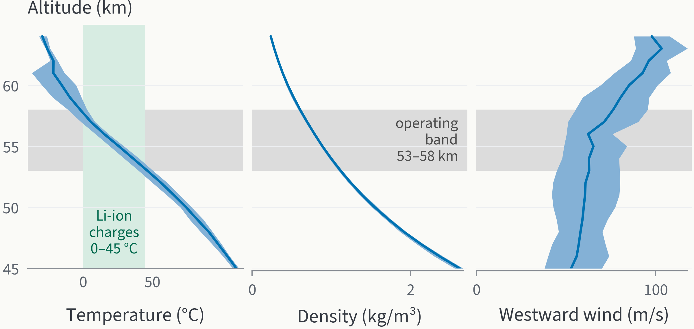

**F1.** *Only 53–58 km gives a battery that can charge (0–45 °C) in air as dense as Earth's.* Pioneer Venus
four-probe mean (line) and envelope (band) of temperature and density; westward wind: mean of the probes with a sample
within ±0.5 km (2–4 probes, see below); grey: operating band.

Atmosphere from the raw Pioneer Venus probe tables [D] (31.3°S–59.3°N, 00–08 h local time, Dec 1978), mean and
probe envelope — `aerokit.venus.atmosphere.state` (wind band = probe min/max ± 10 m/s [Y]). T, p and ρ are 4-probe
linear interpolations; an independent audit re-derived every cell from the raw rows (`R_audit_2026-11-04.md`). The
wind column is different: it is the mean of the probes that have a DLBI sample within ±0.5 km (3 probes at 53–58 km,
2 at 60 km), not a 4-probe mean. Interpolating all four probes gives 60 / 62 / **63** / 74 / 85 m/s at
50 / 53 / 55 / 58 / 60 km (my rerun of the raw tables, `D:/tmp_ideathon/venus/r3/wind_check.py`), 0–2.4 m/s below the
column. We keep the column: the difference is inside the ±10 m/s band [Y] and errs on the safe side (63.4 m/s makes
the air-mass day 158.6 h instead of 154.1 h, so the sunlit window is ~3 % longer than we fly):

| z (km) | T (°C) | p (bar) | ρ (kg/m³) | ρ band | wind W (m/s) | what it means for VESPER [K] |
|---:|---:|---:|---:|---|---|---|
| 50 | 74.7 | 1.029 | 1.550 | 1.52–1.58 | 60 (43–78) | battery interior 84 °C steady: dives only |
| 53 | 46.6 | 0.683 | 1.118 | 1.09–1.14 | 63 (45–80) | lower edge: interior 57 °C, no charging |
| **55** | **26.0** | **0.508** | **0.889** | **0.867–0.907** | **65 (49–84)** | **cruise: interior 37 °C, charges; hover 2.09 kW** |
| 58 | −2.1 | 0.314 | 0.606 | 0.58–0.62 | 76 (55–96) | upper edge: hover 2.52 kW (+21 %) |
| 60 | −15.4 | 0.223 | 0.452 | 0.43–0.46 | 85 (69–101) | hover 2.91 kW (+39 %) |

Other sourced facts: cloud layers 47.5–50.5 / 50.5–56.5 / 56.5–70 km, droplets of 75–90 wt% H₂SO₄ observed (a model gives 98 % at the ~48 km cloud base; Titov 2018)
[D-ag]; the 51–56 km layer is near-adiabatic (convective) at all four probe sites — lapse within ±1 K/km of g/cp
[D-ag; reproduced in our test]; VEGA balloons at 53–54 km: vertical air motion σ 0.65–0.75 m/s, −3.5…+2 m/s,
the largest downdraft −2…−3.3 m/s over ~2 h pushed VEGA-2 ~2.9 km down (4 h recovery), horizontal fluctuations up to 1–2 m/s at 30–130 s periods [D-ag]; zonal wind
66–69 m/s at 53–54 km (VEGA), 60 ± 10 m/s at ~47 km (Venus Express), decadal changes up to 30 m/s [D-ag]; lightning unproven
(Akatsuki 16.8 h, no flashes [A via agent]). The Wikipedia/VIRA-like table sits at the *dense* edge of the probe
envelope at every level (test) — sizing on it would flatter the rotorcraft by ~4 % in density.

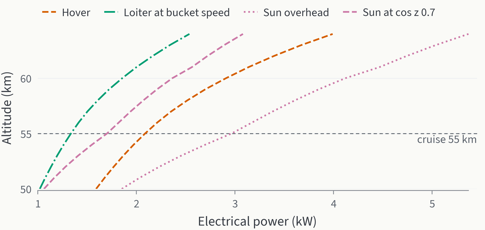

**F2.** *An overhead Sun covers even hover at every altitude from 50 to 64 km; loiter is covered down to cos z ≈
0.6.* Electrical power for VESPER (BEMT, 43.7 kg) vs available bifacial-array output.

Why 55 km [K]:
1. **Battery and electronics**: Li-ion charges at 0–45 °C, discharges −20…60 °C [D-ag, Panasonic NCR18650B
   datasheet]. With the vessel thermal model (§4.6) the interior is 37 °C at 55 km, 27 °C at 58 km, held ~25 °C
   above, but 57 °C at 53 km and 84 °C at 50 km.
2. **Power**: hover power rises as 1/√ρ — 1.59 kW at 50 km, 2.09 kW at 55, 2.91 kW at 60, 3.99 kW at 64 km.
   Sunlight rises with altitude too (Landis & Haag 2013 array output 256 / 404 / 559 W/m² at 50 / 55 / 60 km [D-ag]),
   so *solar power per watt of hover* is almost flat from 54 to 62 km. The deciding term is mass: the same mission
   sized for 58 km closes at 51 kg and flies 41 h (vs 44 kg and 49 h at 55 km; sensitivity, §7).
3. **Science and environment**: inside the middle cloud (droplets, H₂SO₄ chemistry, convection) with short dives to
   51 km to sample the lower cloud.
4. **Wind**: unavoidable everywhere (49–84 m/s band at 55 km) — so the vehicle lives in the air-mass frame (§4.7).
5. **Latitude**: the entry is targeted within ±15° of the equator — flight time 49 h at 0°, 48 h at 15°, 44 h at 30°,
   32 h at 45° (sun lower; the air-mass day length is taken as equatorial [Y]).

## 4. Question 2 — rotors, propulsion, materials, power, thermal: what it looks like

### 4.1 Configuration choice [Y with K numbers]

| Option | For | Against | Verdict |
|---|---|---|---|
| Coaxial (Ingenuity-like) | compact, one mast | coaxial induced-power penalty κ_int 1.27–1.35 (our BEMT; Syal 2008 ideal 1.27–1.28 [D-ag]); the Mars Science Helicopter study judged a large coaxial difficult to control (flap 1.54/rev, 32 Hz) and chose a hexacopter [D-ag, paraphrase] | no |
| Quadrotor | simplest | no motor-out tolerance | no |
| **Hexacopter, 6 × 2.6 m, geared** | motor-out tolerant, rotors do not overlap, a solar deck fits between them, MSH heritage (31 kg hex in a 2.5 m aeroshell [D-ag]) | 8.0 m span to fold | **baseline** |
| Octo-coax (Dragonfly-like) | redundancy | coax penalty, mass | no |

### 4.2 Rotors (BEMT, validated) and why 2.6 m, geared [K]

`aerokit.venus.bemt`: blade-element momentum theory with Prandtl tip loss, Reynolds-scaled drag, Prandtl–Glauert lift,
coaxial wake model; vectorised (one solve ≈ 0.1 s). Design rules: MSH used C_T/σ 0.11–0.115, a 40 % thrust
margin to stall and tip Mach ≤ 0.7–0.8 [D-ag]; we take C_T/σ = 0.10 for extra stall margin [Y]. Trade over 72 design points (69 close) (`04_Venus/scripts/venus_trade.py`, F7): bigger rotors lower
the sun height needed but add mass; at 2.6 m, 55 m/s tip speed needs slightly less sun (cos z 0.58 vs 0.60) but is
3 kg heavier, 90 m/s is 1 kg lighter but needs more sun (0.65) — 70 m/s is the compromise. Robustness (F10,
§7) decided the rest: with **direct-drive** motors the closure diverges for 180 Wh/kg cells or 5 N·m/kg motors; with a
**5:1 geared drive** every adverse case closes and still flies ≥ 43.8 h; 2.6 m keeps ~6–11 h more than 2.3 m in each
case.

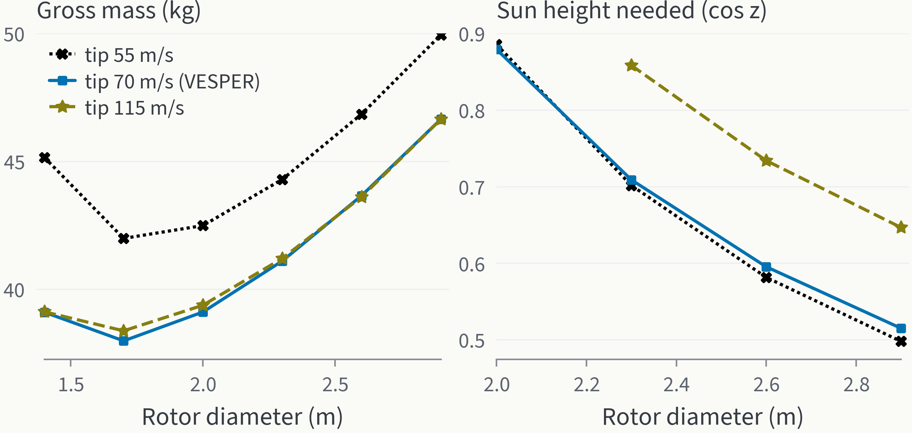

**F7.** *Bigger rotors buy sunlight-sustained flight at a mass cost.* Left: closed gross mass; right: sun height
(cos z) above which the array carries loiter flight (only designs where it ever does).

| Rotor quantity at 55 km | Value |
|---|---|
| diameter / blades / solidity | 2.6 m / 2 / 0.027 (root chord 78 mm, tip 47 mm, −12° twist; blade aspect ratio ~21) |
| hover rpm / tip speed / tip Mach | 514 rpm / 70 m/s / 0.26 |
| Re at 0.75 R | 1.7×10⁵ (Ingenuity ~1.1×10⁴ [D-ag]: Venus rotors are in the *Earth* regime, not Mars') |
| collective (θ₀.₇₅) / figure of merit | 7.0° / 0.60 (includes the +5 % torque correction from the Knight & Hefner validation) |
| disk loading | 11.9 N/m² (MSH hexacopter on Mars 8.5 N/m² [K from D-ag 2.29 kg/m² × 3.71 m/s²]) |
| hover torque / shaft power per rotor | 5.1 N·m / 272 W (motor side: 1.0 N·m at 2570 rpm) |
| max airspeed at 1.6^1.5 × hover power | ~23 m/s (`aerokit.venus.control.max_airspeed`) |
| blade first flap frequency | 1.7/rev rotating, 11 Hz non-rotating, 6.5 cm hover tip deflection (`structure.blade_flap`; MSH hex 1.55/rev, Ingenuity ~2/rev [D-ag]) |

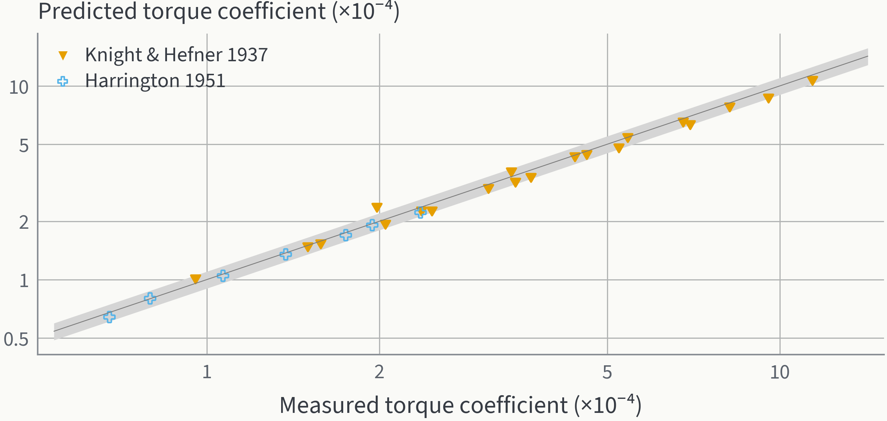

**F8.** *BEMT predicts measured rotor torque within ±10 % at 26 of 27 points (rms 6.3 %; worst 21 %: 5-blade
rotor at 4° pitch, near zero thrust).* Knight & Hefner 1937 (2–5 blades, predicted
from the report's own NACA 0015 polar at Re 2.4×10⁵) and Harrington 1951 rotor 1 (digitised); band ±10 %.

### 4.3 Propulsion and drive [Y with K]
Sm₂Co₁₇-magnet motors (≈300 °C limit; NdFeB SH 150 °C [D-ag]) with a single-stage 5:1 planetary gearbox in one
PFA-sealed can per rotor (gearbox 25 N·m/kg, 95 % efficient [Y]): hover torque 5.1 N·m at the rotor, 1.0 N·m at
2570 rpm at the motor; motors + gearboxes 3.3 kg for all six (the direct-drive version — `sizing.close` with gear_ratio 1 — closes at 54.6 kg with 9.3 kg of motors). **Per-rotor
collective-pitch actuators** for *attitude* control: changing thrust by rotor speed takes ~0.3–1 s for these large
rotors (`control.rpm_response_time`) — enough for altitude in Venus' slow vertical gusts (§4.7) but too slow for
Hz-level attitude control by differential thrust [K]; the MSH study rejected a large coaxial as hard to control
because of its low flap frequency [D-ag]. Winding
temperature at hover ≈ ambient + 18 K (`thermal.motor_temperature`, motor conductance assumed).

### 4.4 Power [K]
- **Solar deck**: 4.45 m² hexagon between the rotors (corners 5 cm inside every disk edge: no wake download), bifacial
  triple-junction cells (29 % AM0 array), Parylene + FEP cover (Parylene alone tested: −5 % [D-ag]; FEP cover loss not quantified). The cloud deck reflects 84–89 % of the
  downward light back up at 50–62 km (Pioneer Venus radiometer [D]) — the underside earns ~73 % of the topside
  [Y bifaciality 0.85]; the vessel shades ~6 % of the underside, not modelled (≈ −2.7 % array power). Output 2.97 kW
  with the Sun overhead at 55 km. Sun-angle law: in-cloud Eddington-type
  μ₀(μ₀+⅔)/(5/3) [Y]; consistent with the probe radiometer within its in-band share (`power.py` docstring).
- **Battery**: 1.04 kWh Li-ion (18650 energy cells 243 Wh/kg [D-ag], pack 75 %, DoD 85 % [Y]) = 0.5 h of hover with no
  sun. A 1 h reserve does not close (mass growth factor > 1).
- **Day cycle**: drifting at 65 m/s the Sun circles the air mass in ~6.5 Earth days (the Sun's own slow motion included; a pure circumnavigation at 65 m/s takes 6.8 days) → ~3.2 days
  (77 h) of light, ~3.2 of
  night. Release is targeted (entry time and site) at the morning hour angle where the array first covers loiter
  (−51°).

### 4.5 Materials vs sulfuric acid (`aerokit.venus.materials`) [D-ag rows]
FEP keeps 95 % strength after 168 h in concentrated H₂SO₄ at 120 °C, 0 % weight gain; the JPL aerobot FEP/Kapton
laminate survived 96 % acid at 100 °C under load; Parylene-coated cells: no loss after 96 h in 96 % acid; bare titanium
corrodes in concentrated acid at room temperature (1.6 mm/y) but not in 96 % vapour; 316L only cold and concentrated;
**no data found for CFRP in concentrated acid** → blades and arms are CFRP wrapped in FEP with a PFA leading-edge
strip, and that wrap is a qualification item.

### 4.6 Thermal [K]
Two-node vessel (interior / Ti shell), aerogel blanket (1.75 W/K) in parallel with a **variable-conductance heat pipe
used as a diode** to shell fins (up to 12 W/K), silvered-FEP skin (α 0.08, ε 0.52 [D-ag]), Churchill–Bernstein
convection in CO₂. Interior 37 °C at 55 km. A science dive to 51 km (5 min at the bottom) heats the battery to 57 °C —
the peak comes during the climb back because of thermal lag — below the 60 °C discharge limit, with charging paused
above 45 °C; any dive to 48 km passes 60 °C. The mission logic also aborts a dive if the interior passes 50 °C at depth. Without the diode the heat pipe would *import* heat during a
dive — found by the transient model and fixed.

### 4.7 Control and navigation [K]
- **Air-mass frame**: maximum airspeed ~23 m/s vs 49–84 m/s wind — VESPER cannot hold a ground position and does not
  try; it controls altitude and position *relative to the air*. Ground track is a planning output.
- **Vertical gusts**: the rotors' own heave damping (BEMT ∂T/∂w = −32 N per m/s) makes the vehicle follow vertical air
  motion within ~1.4 s. With altitude hold in VEGA-like turbulence (σ 0.7 m/s [D-ag statistics]; 80 s correlation [Y], inside the 30–130 s fluctuation periods [D-ag]) the
  altitude error is 4 m RMS (11 m peak) and thrust excursions peak at 14 % of weight — well inside the 60 % margin
  (`control.gust_response`, gains [Y]).
- **Downdrafts** (VEGA-2: −2…−3.3 m/s over ~2 h, ~2.9 km down [D-ag]): holding altitude in a 3 m/s downdraft costs +1.4 kW (as much as
  loiter); riding it 3 km down and climbing back costs ~0.4 kWh → policy: ride it within 51–58 km.
- **Navigation without GNSS**: barometric altitude ±0.19 km (probe-to-probe pressure spread at 55 km); no magnetic field
  (VAPS [D-ag]); gyrocompassing on Venus' 2.99×10⁻⁷ rad/s rotation (from the 243.0-day sidereal period [K]) gives ~9° heading error with a 0.01 °/h gyro
  (ratio 6) and is impossible with MEMS gyros; a Sun fix better than 10° inside the clouds "may be impractical" (VAPS [D-ag]) → IMU +
  airspeed dead reckoning in the air frame (Ingenuity drift 1–6 % [D-ag]) + relay-orbiter Doppler/range fixes each pass;
  ground error grows ~5 m/s × time between fixes.
- **Autonomy**: light time 2.3–14.3 min one way (doc 19) → on-board behaviour trees; the ground plans days ahead.

### 4.8 Communications [K]
5 W UHF (401.6 MHz) crossed dipole → relay orbiter in a 1000 km circular orbit: 13 min passes, **~330 Mbit per pass**
with an adaptive rate (receiver noise 700 K incl. hot Venus in the beam [Y]). Above 53 km the path absorption is ~0
(Akatsuki X-band ~0.005 dB/km at 50 km [D-ag]). Our budget arithmetic gives the published VEVA link (400 MHz, 1 W,
200 km, 500 kbps [D-ag]) an 18 dB margin — consistent. DAVINCI's descent sphere returns 154 Mbit–1.2 Gbit in ~1 h by
S-band relay [D-ag].

### 4.9 Structure and packaging [K/Y]
Arms: 80 mm CFRP tubes, 2.7 m, sized by `aerokit.venus.structure.size_arm` for a 3° rotor-plane tilt under 1.6× thrust:
minimum gauge (0.8 mm) governs, 0.36 kg/m, 5.9 cm tip deflection, 68 MPa root stress (allowable 300 MPa [Y]); the
earlier fixed 0.30 kg/m guess was replaced by this sizing. **Z-folded arms** (hinge at the body and at mid-arm, 2 folds
per arm), blades folded back along the outer segment, 6 solar petals folded up against the vessel: stowed envelope
~1.5 m × 2.0 m [Y]; the visual session's folded 3-D model measures 1.57 × 2.12 m, still inside a 3.7 m 45° aeroshell.
Landis' 9 m-span airplane was folded into the same 3.7 m shell (his smaller concept's wing folded in two places)
[D-ag]; NASA Ames notes mid-air deployment has
only been demonstrated for 2–4-fold aircraft [D-ag].

### 4.10 Mass budget and what it looks like (F4, `design.json`)

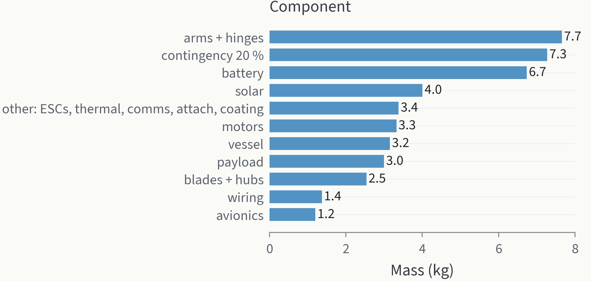

**F4.** *Arms, contingency and battery are the largest items of the 43.7 kg; the geared drive is only 3.3 kg.*
Closed mass budget (`aerokit.venus.sizing`).

Visual hand-off: **`04_Venus/outputs/design.json`** v0.6 (schema `venus_rotorcraft_design/1`, regenerated by
`python 04_Venus/scripts/venus_design.py`; old versions anchored in `04_Venus/outputs/versions/`): atmosphere 30–80 km
with bands and solar fraction, operating band, rotor geometry (6 arms at 30°+60°·i, alternating spin, arm radius
2.7 m, span 8.0 m), body, solar deck, 13 labelled components with positions/sizes/masses/materials/colours, stowed
envelope and fold description, entry and deployment sequence with altitudes and times, mission events (with kind and
altitude) and an hourly series. Simulator hand-off for LuGus: **`sim_params.json`** (every value with unit, tag and source; §6.1) and the short card
`outputs/vesper_for_simulator.json` (mass 43.7 kg, inertia
diag 33 / 33 / 65 kg m², rotor positions/spin, thrust–torque curves vs rpm at 55 km, atmosphere and gust statistics,
deployment replay).

### 4.11 How VESPER flies — Ingenuity's logic carried to Venus [D-ag for Ingenuity, K for VESPER]

| Item | Ingenuity (Mars, 2021–24) | VESPER (Venus, 55 km) | What changes and why |
|---|---|---|---|
| Air density / rotor Reynolds | ~0.015 kg/m³; Re ~1×10⁴ (MSH Table 1) | 0.89 kg/m³; Re 1.7×10⁵ | 60× denser air: Earth-like airfoils and figure of merit, slow rotors (514 vs 2400–2700 rpm) |
| Power per kg in hover | ~350 W for 1.8 kg ≈ 195 W/kg | 2.09 kW for 43.7 kg ≈ 48 W/kg | hover is ~4× cheaper per kg than on Mars |
| Thrust margin rule | ≥ 40 % above hover before stall (Grip 2018) | 60 % motor/thrust margin; gust peaks use 14 % | same rule, more margin for downdrafts |
| Control loop | 500 Hz GNC triggered by the IMU; four open-loop unstable hover modes (stiff rotors) (Grip 2018) | same architecture; collective pitch per rotor for attitude (large rotors respond to rpm in 0.3–1 s) | big slow rotors cannot steer by rpm alone |
| Wind design case | 9 m/s horizontal, 2 m/s vertical, 3.5 m/s gusts (Grip 2018) | 65 m/s mean wind (ignored: air-mass frame), vertical σ 0.7 m/s, downdrafts −3.3 m/s (VEGA) | the mean wind is a frame, not a disturbance |
| Navigation | IMU + inclinometer (ground only) + lidar altimeter + downward camera feature tracking (Balaram 2018) | IMU + airspeed + barometric altitude + relay Doppler; no ground in view, no magnetic field | camera ground tracking impossible inside clouds |
| Thermal | heaters keep the battery above −15 °C in −100 °C nights; flights only at +10…+25 °C (JPL battery note) | heat pipe *cools* the battery to 37 °C at 55 km; dives limited by the 60 °C discharge limit | Venus' problem is heat, not cold |
| Flight profile | 72 flights, 128.8 min in total, max 24 m altitude, 10 m/s (JPL) | one 49 h flight, 51–55 km, loiter 7.8 m/s | sunlight sustains flight instead of recharging between hops |
| Getting there | dropped from the rover belly on the ground (rover-carried) | spun up under a parachute and released at 61 km (Dragonfly practice) | no surface to start from |
| End | stranded on the ground with a damaged blade (Jan 2024) | sunset dive, then an unpowered fall | — |

## 5. Question 3 — how does it get there? (F3)

| Phase | Numbers | Tag |
|---|---|---|
| Launch, Earth → Venus | Hohmann v∞ 2.71 km/s (floor), transfer ~146 days [K]; design v∞ 3.5 km/s [Y] | K/Y |
| Carrier = relay orbiter | releases the probe ~5 days out; capture into the 1000 km relay orbit would need ~3.4 km/s if propulsive [K] — aerobraking or an elliptical relay orbit is cheaper (open item) | K/Y |
| Entry interface | 200 km, 10.78 km/s, γ −9.5° (corridor −8…−11°, skip-out at −7°) | K |
| Entry capsule | 3.7 m 45° sphere-cone; 284 kg (vehicle 20 %, Landis fractions + 30 % [D-ag]); β 25.1 kg/m² | K |
| Peak deceleration / heating | 56 g at 92 km; 228 W/cm² convective (Sutton–Graves, k = 1.897×10⁻⁴ derived by the agent from Table II [D-ag]) + 18 W/cm² radiative (Tauber 2012 [D-ag]; fit extrapolated from r_N 0.36 m to our 0.93 m nose); 3.9 kJ/cm² — vs Pioneer Venus large probe 288 g and ~4 800 W/cm² in our model (280 g in SP-461 [D-ag]) | K |
| Parachute | pilot (mortar), then 12 m main at ~200 m/s, 79 km (Mach ~0.9); heat shield off; 716 s to release; 12.8 m/s at 61 km | K/Y |
| Unfold under the chute | rotorcraft lowered 10 m on a bridle; arms, blades, solar petals spring out (~69 km) | Y |
| Spin-up while hanging | rotors to hover rpm under the chute (~63 km) — Dragonfly practice: rotors spun under the main chute, release below 2.9 m/s [D-ag] | Y/D-ag |
| Release and pull-out | 61 km, 12.8 m/s descent; arrested in 3.4 s, **26 m lost** (vs **559 m** if dropped unspun with a MAHD-like 3 s free fall + 12 s spin-up [D-ag]); crosses the vortex-ring band in forward flight | K |
| Descent to cruise | 3 m/s to 55 km (~33 min) | K |

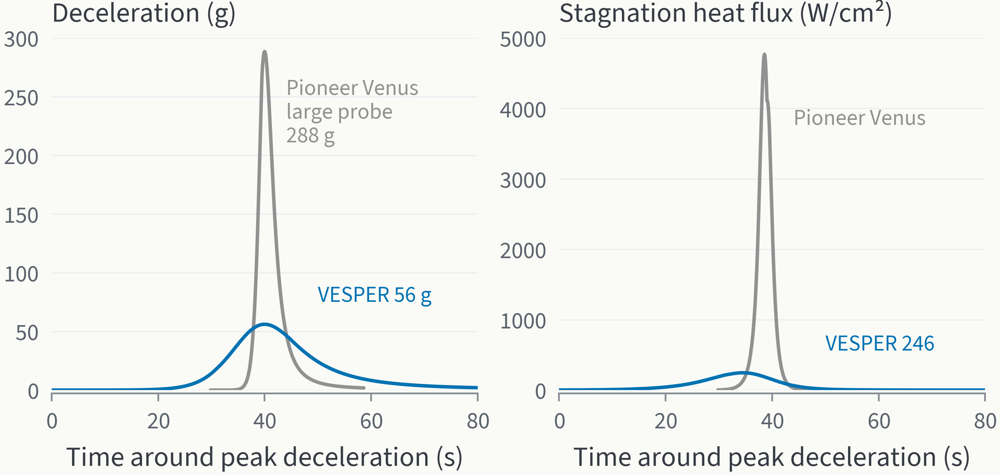

**F3.** *A shallow, low-β entry keeps VESPER near 56 g; Pioneer Venus' steep entry reached 288 g in our model (276–280 g reported).* Our 3-DOF
simulation of both (PV: β 190, −31.8°, inputs from Tauber 2012 [D-ag]); heat flux = convective + radiative.

Precedents [D-ag, `B_00_index.md`]: Venera 9–14 entered at −18…−23°, parachutes opened at ~62–65 km and (Venera 11, 12, 14) were
dropped at 46–47 km; Vega balloons were extracted at 61 km and inflated at 54 km within ~5 min of entry [A, PDS
catalogue summary], floated at 53–54 km for ~46 h [D-ag]; DAVINCI (planned): 10.4 km/s at −6.3°, 32 g, 1.8 m pilot at Mach 0.8, 5.8 m main at ~70 km.


### 5.1 Entry validation against every Venus entry with published conditions (F11) [K vs D-ag]

`python 04_Venus/scripts/venus_entry_validation.py` flies our entry model with the ballistic coefficient, angle, speed
(200 km interface) and size of each historical probe as tabulated by Dutta, Smith, Prabhu & Venkatapathy 2012
(Table 1; their peak g and heat flux are engineering re-simulations, not measurements) and compares with flight-
reported values where they exist (SP-461, Siddiqi 2018 via agent notes). Nose radius: sphere D/2, 45° cone D/4
(gives 0.356 m for the PV large probe vs 0.363 m published) [Y]. "Mach 0.8 altitude" is where our trajectory slows
to Mach 0.8 — compared with the published parachute/heat-shield events.

| Case | β (kg/m²) | γ (°) | V (km/s) | peak g: ours / Dutta (err) | flown g (err) | peak q kW/cm²: ours / Dutta (err) | Mach 0.8 alt. ours (event) |
|---|---:|---:|---:|---|---|---|---|
| Venera 4 | 519 | -78.0 | 10.7 | 416 / 450 (-8 %) | 300 (+39 %) | 9.3 / 9.66 (-3 %) | 57.4 km |
| Venera 8 | 670 | -77.0 | 11.6 | 480 / 500 (-4 %) | 335 (+43 %) | 31.3 / 30.0 (+4 %) | 55.7 km |
| Venera 9 | 367 | -20.5 | 10.7 | 151 / 150 (+1 %) | — | 3.1 / 3.04 (+1 %) | 64.3 km (65 km) |
| Venera 10 | 367 | -23.0 | 10.7 | 169 / 170 (-1 %) | 168 (+1 %) | 3.5 / 3.37 (+2 %) | 63.9 km |
| Venera 11 (-18°) | 376 | -18.0 | 11.2 | 143 / 138 (+3 %) | — | 3.9 / 4.35 (-10 %) | 64.5 km |
| Venera 13/14 (-21°) | 387 | -21.0 | 11.2 | 167 / 167 (+0 %) | — | 4.8 / 4.35 (+10 %) | 63.9 km |
| Vega 1 | 412 | -18.23 | 10.7 | 132 / 130 (+1 %) | — | 3.0 / 3.06 (-2 %) | 64.0 km (64 km) |
| Vega 2 | 412 | -19.08 | 10.8 | 140 / 139 (+1 %) | — | 3.3 / 3.29 (+1 %) | 63.9 km |
| PV North | 190 | -68.7 | 11.5 | 481 / 487 (-1 %) | 458 (+5 %) | 7.6 / 10.6 (-28 %) | 63.3 km |
| PV Night | 190 | -41.5 | 11.5 | 349 / 350 (-0 %) | — | 5.8 / 7.8 (-25 %) | 65.1 km |
| PV Day | 190 | -25.4 | 11.5 | 233 / 219 (+7 %) | 223 (+5 %) | 4.2 / 5.2 (-20 %) | 67.0 km |
| PV Large | 188 | -32.4 | 11.5 | 287 / 276 (+4 %) | 280 (+3 %) | 4.6 / 6.9 (-34 %) | 66.1 km (67 km) |

Venera 11–14: Dutta Table 1 gives β per probe, 376 / 379 / 387 / 387 kg/m² (V11 / V12 / V13 / V14), but one shared
range for γ (−18 to −21°) and peak g (138–167) and one heat flux (4.35 kW/cm²). The two rows use the extreme probes
(V11 β 376, V13/14 β 387; until 4 Nov 23:00 both rows used an unprinted 380, flagged by the audit). The pairing of
138 g with −18° and 167 g with −21° is ours [Y]. The ±10 % heating in these two rows is the spread of the
−18…−21° range against Dutta's single value, not a model error. Effect of the switch from 380 (rerun, `outputs/entry_validation.json`):
peak g rms 3.53 → 3.51 %, worst unchanged 7.5 %; heat-flux rms (excl. Venera 8) 17.0 → 16.9 %; the rows moved by
≤ 0.4 % in g and ≤ 2 % in heat flux.

- **Peak deceleration: 3.5 % rms, worst 7.5 % (Venera 4)** against the 12 re-simulated cases; against the
  flight-reported values within 5 % for all four Pioneer Venus probes and Venera 10. The steep Venera 4/8 flight
  values (300/335 g) are 40 % below *both* re-simulations — the entry angles of those probes are only known as a
  range (−60…−80°), so those two rows test the inputs more than the model.
- **Peak heat flux: within 5 % for every Venera/Vega case with a single published angle (±10 % for the Venera 11–14
  angle range); 20–34 % low for the four Pioneer Venus probes** (45°
  cones, small noses, where Dutta's correlation gives more radiative heating than Tauber's fit extrapolated outside
  its range). Our heat-flux numbers are therefore trustworthy to ~±10 % for blunt spheres and possibly 30 % low for
  small cones — VESPER's 3.7 m cone has a 0.93 m nose and is convective-dominated (228 of 246 W/cm²).
  For the PV large probe the published estimates themselves differ: Dutta 6.9 kW/cm²; Tauber 2012 radiative 2.45 +
  Cabrera & West convective 1.38 ≈ 3.8 kW/cm² (coupled ablation: 2.03 + 1.38 = 3.4) [D-ag]; ours 4.6 kW/cm² lies
  between them.
- **Parachute altitude: our Mach 0.8 point is 64.3 / 64.0 / 66.1 km where Venera 9 dropped its cover at ~65 km,
  Vega opened its cap chute at 64 km [A] and the PV large probe dropped its heat shield at ~67 km.**
- **DAVINCI** (planned; β not published because the entry-system mass is not, so swept 50–200 kg/m²; its −6.3° is
  quoted at a 145 km interface): 29–34 g vs 32 g published; Mach 0.8 at 68–75 km vs the main chute at ~70 km.
- **VESPER's own point** (β 25, −9.5°): 56 g and 246 W/cm², inside the contour Dutta 2012 Fig. 1 gives for β ≈ 30,
  γ ≈ −10° (~50–60 g, 250–350 W/cm², read off the plot by the agent) [D-ag].

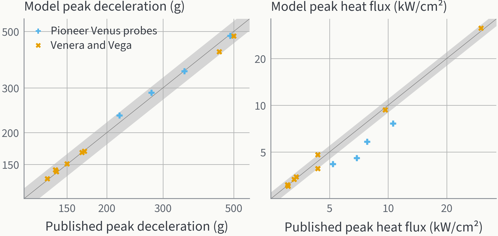

**F11.** *The entry model reproduces 12 historical peak decelerations within 8 %; heating within 10 % for spheres (±10 % is the Venera 11–14 angle range),
20–34 % low for the small Pioneer Venus cones.* Our model vs Dutta et al. 2012 Table 1; band ±10 %.

### 5.2 Deployment timeline: loads, attitudes, decision points and abort paths [K/Y]

| t (s) / alt (km) | Event | Load | Attitude | Decision (go if…) | Abort path |
|---|---|---|---|---|---|
| 0 / 200 | entry interface, 10.78 km/s, −9.5° | — | spin-stabilised aeroshell | — | — |
| 80 / 92 | peak deceleration | **56 g**, 246 W/cm² (qualify to 100 g) | aerodynamically stable 45° cone | — | — |
| 139 / 79 | pilot (mortar) → main 12 m at ~200 m/s, Mach ~0.9 | unreefed: 27 kN ≈ 12 g → **staged/reefed opening ≤ 5 g** [Y] | under canopy | g-trigger + timer (DAVINCI practice [D-ag]) | none: chute failure = loss |
| 149 / 78 | heat-shield jettison | separation shock | — | accelerometer step + range sensor | stuck: stay on the chute as a **descent probe** (payload sensors, ~1 h of data, DAVINCI-like) |
| ~360 / 69 | lower 10 m on a bridle; arms (Z-fold), blades, petals spring out | < 1 g | hangs vertical, pendulum period 6.7 s | 12 latch sensors | ≥ 2 arms unlatched → descent probe |
| ~640 / 63 | rotors spun up at the zero-lift collective (≈ −16° at 0.75 R: the 12.8 m/s descent sets a 13.7° inflow; at flat pitch they would pull ~1.2 W on the bridle, §7.2-5) | ~2.3 s per rotor; alternating spins cancel torque | swing < 0.3° (Monte Carlo) | rpm + current on 6 motors | ≤ 4 healthy → descent probe (5 of 6 flies: hex motor-out tolerance) |
| ~770 / 61 | release, collective to 1.6 W, pitch forward to 2 v_h | +0.6 g net | nose-down ~10–15° [Y] | window 63–60 km, descent < 16 m/s, battery > 90 % | window missed → stay on the chute to 58 km, then descent probe |
| +3.4 s | descent arrested, 26 m lost (p99 41 m) | 0.6 g | level | loss < 300 m | loss > 300 m → full collective + forward flight |
| ~2770 / 55 | cruise reached (3 m/s descent from 61 km) | 1 g | loiter 7.8 m/s | — | — |

### 5.3 Deployment Monte Carlo over the measured winds (F12) [K with D inputs]

300 runs per procedure: wind profile drawn from the Pioneer Venus DLBI probes with samples at the release altitude
(Large up to 64.6 km, Day 62.5 km, Night 61.4 km; North stops at 59.3 km; no measured wind above 64.6 km [D]). The
chute drift is flown from 64 km (top of the probe grid) to the 61 km release, with the wind held at its last sample, extra shear ±2 m/s per km (VEX 8 ± 2 m/s/km at 61–66 km [D-ag]), horizontal gusts σ 1 m/s and vertical
gusts σ 0.7 m/s (VEGA [D-ag]), density thin/mean/dense, thrust ramp 1–3 s, one motor failed with 2 % probability
[Y] (`descent.deployment_monte_carlo`).
- **The measured shear does not matter**: the parachute follows the air so closely that at release the rotorcraft
  moves at 0.7 m/s (median) relative to the local air; swing under the canopy < 0.3°.
- **Pulling out in forward flight**: 27 m lost (median), 41 m (p99), never inside the vortex-ring band.
- **Pulling out straight down**: 30 m (median), 55 m (p99, max 60 m), and *every* run crosses the vortex-ring band
  (up to 4.9 s) — the reason for the forward-flight procedure, as in helicopter practice.

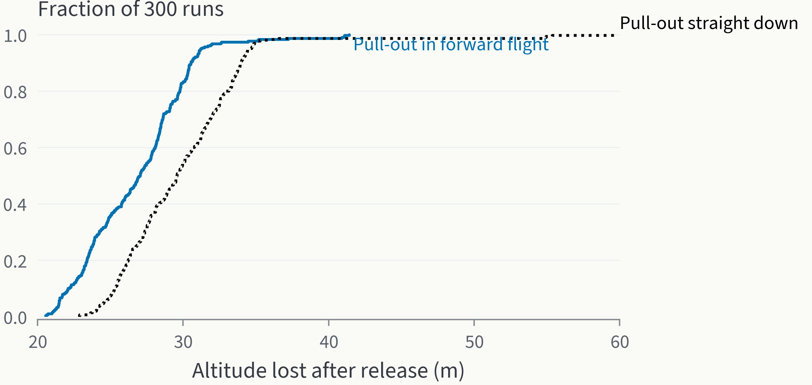

**F12.** *Pulling out in forward flight keeps every release under ~41 m of altitude loss and out of the vortex-ring
state.* Distribution of altitude lost over 300 Monte Carlo runs per procedure.

## 6. Mission (F6)

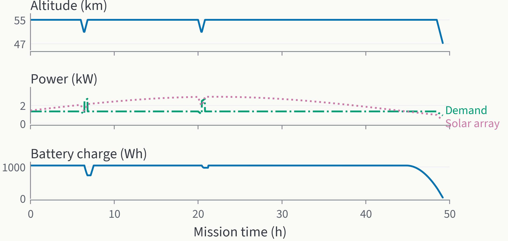

**F6.** *VESPER flies 49 h, 44 h of it on sunlight, and ends in a sunset dive.* Altitude, electrical demand vs array
output, battery energy; release at hour angle −51° (`aerokit.venus_flight.simulate_rotorcraft_day`).

Timeline [K]: release at 55 km → science dives to 51 km at 6 h and 20 h (5 min at the bottom; battery peaks at 57 °C
during the climb back) → the array carries loiter until the Sun falls below cos z ≈ 0.6 (48.5 h) → sunset dive measuring
through the middle cloud to 47.3 km, where the battery passes 60 °C (49.2 h). Drift: 11 500 km (about 30 % of the way
round Venus — comparable to VEGA's ~11 600 km [A] in ~46 h [D-ag]). Science [Y]: aerosol size/composition through the cloud
layers, H₂SO₄/SO₂/H₂O, turbulence and vertical winds (the vehicle *is* an anemometer in the air frame), up/down
radiative fluxes (bifacial array = radiometer), imaging of cloud structure.

### 6.1 What LuGus would simulate (the sponsor builds drone simulators — doc 19) [K numbers, Y scenarios]

**`sim_params.json`** (`python 04_Venus/scripts/venus_sim_params.py`, README `sim_params_README.md`) is the simulator-ready
superset: atmosphere/wind/solar table 30–80 km every 0.5 km, rotor curve, mass and inertia, drive/power/thermal
parameters, 11 limits and 9 failure modes (trigger → effect → recovery), deployment replay and mission series;
every value carries its unit, tag and source. `outputs/vesper_for_simulator.json` is the short flight-model card: 43.7 kg, inertia diag 33 / 33 / 65 kg m², six rotor
positions and spins, BEMT thrust/torque vs rpm at 55 km (10 N at 206 rpm … 166 N at 823 rpm per rotor; hover 63 N at
514 rpm), drag area, atmosphere, gust statistics and a 338-frame deployment replay. Training scenarios that exercise the
real constraints:
1. **Drop and catch** — release from the parachute at 61 km descending 12.8 m/s; arrest within ~30 m by flying forward
   through the vortex-ring band (fail if hovering straight down at 0.5–1.5 v_h).
2. **Ride the downdraft** — a VEGA-2-like 3 m/s, ~2 h downdraft: holding altitude costs +1.4 kW; the right call is to
   ride 3 km down and climb back (0.4 kWh).
3. **Dive budget** — dive to 51 km for samples while the battery interior climbs toward 57 °C; abort logic at 50 °C.
4. **Relay windows** — a 13-minute pass every ~1.8 h (1000 km orbit); store-and-forward, no live stick from Earth
   (2.3–14.3 min light time).
5. **Sunset** — choose when to start the final dive so the last data leave on the last relay pass.

### 6.2 A whole Venus day: where VESPER works, where it fails, and the margins (F13, F15) [K]

Drifting with the 65 m/s super-rotation at 55 km, one air-mass day lasts 154 h (6.4 Earth days). The array follows
the Sun: zero for the ~77 h night, up to 2.97 kW at local noon. VESPER is released 16.6 h after dawn, when the array
first carries loiter (1.34 kW), and flies 49 h until the Sun is too low again (F13a). **It fails at night**: a 3-day
night at loiter power needs ~103 kWh against 1.04 kWh stored (ratio 0.01).

**Station-keeping vs drifting**: holding a ground position means flying at the wind speed, 49–84 m/s at 55 km. The
rotors would run at an advance ratio of 0.7–1.2 (outside any rotor's envelope; the momentum model stops at ~30 m/s,
μ 0.43), and the airframe drag alone at those speeds needs 24–119 kW — 17–90× the whole loiter budget (F13b).
Drifting costs nothing; VESPER navigates in the air-mass frame.

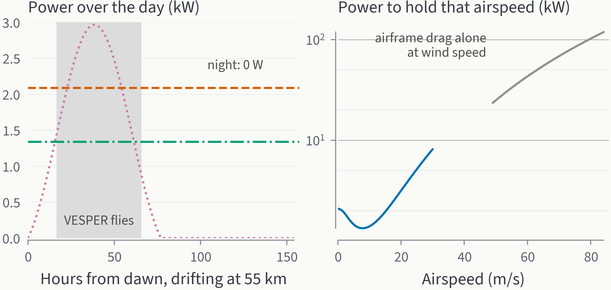

**F13.** *Sunlight carries VESPER for ~2 of the ~6.4 days of a drifting Venus day; holding a ground position would
cost tens of kW.* (a) Array output over the air-mass day vs loiter and hover demand, grey: the mission. (b) Power to
hold an airspeed (model to 30 m/s) and the airframe-drag lower bound at the measured wind speeds.

| Limit | Value | Margin |
|---|---|---|
| Noon solar / loiter power | 2.97 / 1.34 kW | 2.2× |
| Thrust margin / gust thrust peak | 60 % / 14 % of weight | 4.3× |
| Arm stress allowable / actual | 300 / 68 MPa | 4.4× |
| Entry-g qualification / peak | 100 / 56 g | 1.8× |
| Tested acid exposure / mission | FEP 168 h at 120 °C / 49 h (FEP skin only; CFRP, hinges, seals untested) | 3.4× |
| Tip-Mach cap / hover | 0.7 / 0.26 | 2.7× |
| Release altitude margin / p99 pull-out loss | 6000 / 41 m | ~150× |
| Battery charge headroom: (45 °C − air) / (interior − air) at 55 km | 19 / 10.6 K | 1.8× |
| Dive headroom: (60 °C − cruise) / (dive peak − cruise) | 23.4 / 20.6 K | 1.13× — **thinnest above 1** |
| Night energy stored / needed | 1.04 / ~103 kWh | **0.01 — fails** |

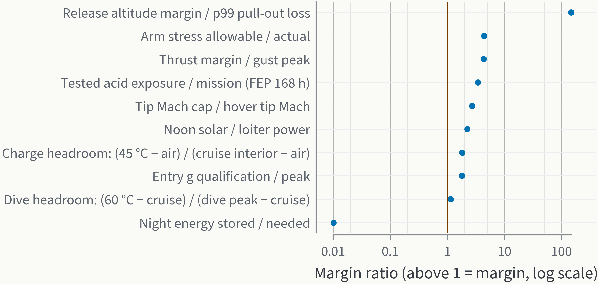

**F15.** *Every margin is above 1 except the night; the battery temperature in dives is the thinnest.* Margin
ratios (log scale; 1 = at the limit).

### 6.3 Does it land? No — end of mission and why (F14) [K]

VESPER **never lands on the surface (≈ 460 °C, 92 bar) and is not designed to**. The mission ends at sunset: a
measuring dive through the middle cloud until the battery passes its 60 °C discharge limit at ~47 km (49 h). After
that it falls unpowered:
- **Rotors windmilling** (they act as a rotary-wing decelerator, the idea NASA Ames proposed for Venus probes,
  Young et al. 2004 [D-ag]; drag area C_D 1.2 × 32 m² [Y]): ~12.4 h to the surface, touching down at < 1 m/s. The
  battery bay passes 125 °C (electronics limit, AEC-Q100 grade 1 [D-ag]) after 1.6 h at ~34 km — data can continue to
  about there if the avionics are kept alive past the battery limit [Y].
- **Rotors failed or blades burnt** (CFRP/epoxy softens well before the surface temperature [Y]): 1.35 h to the
  surface at ~5 m/s; electronics dead at ~16 km after 0.7 h.
- **Even placed on the surface at 25 °C**, the 0.6 m vessel with 1 cm of aerogel reaches 125 °C in **~26 min**.
  Venera 13 lasted 127 min on the surface with a ~750 kg lander built for it [D-ag]; a surface capability would need a
  Venera-class pressure sphere and phase-change heat sinks, not a 44 kg rotorcraft.
- It reaches the surface as debris, hours after the last data. Planetary protection at Venus is not a constraint for
  this end state [Y; not checked against COSPAR policy].

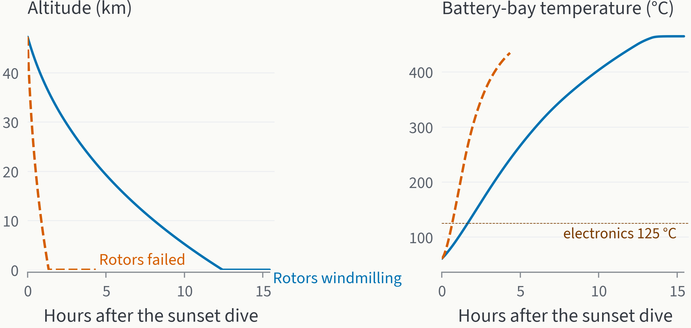

**F14.** *VESPER never lands alive: with windmilling rotors it takes ~12 h to fall, and its electronics pass 125 °C
near 34 km.* Altitude and battery-bay temperature after the sunset dive.

## 7. Feasibility, risks, open challenges (F5, F9, F10)

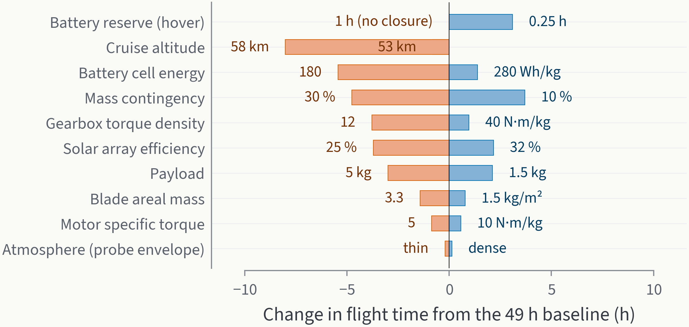

**F9.** *With the geared drive no single assumption costs more than ~8 h of flight — except a 1 h no-sun battery
reserve, which does not close at all.* One-at-a-time sensitivity;
each bar a closed design re-flown (`04_Venus/scripts/venus_sensitivity.py`). "No closure" = no design exists.

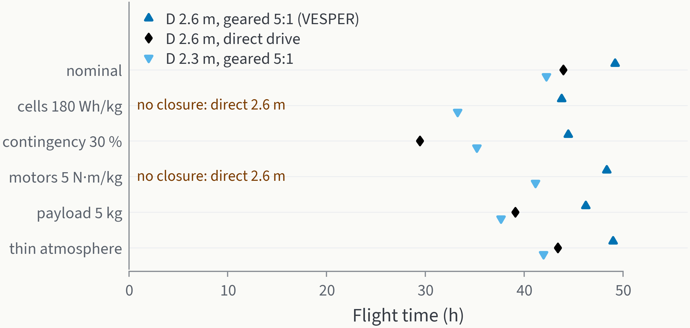

**F10.** *The geared 2.6 m design keeps ≥ 43.8 h under every adverse assumption; direct drive does not even close for
two of them.* Flight hours of three variants.

**Honest feasibility [K/Y].**
- *Physics is favourable*: at 55 km Venus is Earth-like for a rotor (ρ 0.89, Re 1.7×10⁵, tip Mach 0.26); hover costs
  ~48 W/kg, like an Earth drone — not Mars' ~160–200 W/kg (MSH/Ingenuity [D-ag]).
- *Energy is the limit*: a pure rotorcraft cannot store a 3-day night (≈ 1.34 kW × 77 h ≈ 103 kWh). It lives for one
  air-mass day (~49 h). This is the main result to say out loud.
- *Mass growth is the design driver*: each kg added asks for most of a kg more. With direct drive the design does not
  close below ~185 Wh/kg cells or ~5.2 N·m/kg motors (Ingenuity's 163 Wh/kg cells would not close); the 5:1 geared
  drive removes that cliff — 180 Wh/kg cells: 52.5 kg and 43.8 h; 30 % contingency: 51.5 kg and 44.4 h. A 1 h no-sun
  battery reserve still does not close.
- *Entry loads are case-sensitive*: the published ADEPT design envelope (β 25–40 kg/m², −8.5…−9.5°) is 35–45 g and
  350–400 W/cm² (Venkatapathy 2017 [D-ag]); our model gives 37 g at −8.5° (inside) but 56 g at our −9.5° (above it),
  i.e. it is conservative at the steep edge. A single ADEPT case (β 44, −8.5°) matches (35 vs 32 g); a rigid β 208
  case reads 48 g on the slide but the agent notes the column mapping was garbled in text extraction (the other column
  reads 23 g; ours 29 g) — so that "discrepancy" may be an extraction artefact. Our atmosphere is not the issue:
  the Venus-GRAM (VIRA-based) profile changes peak g by < 3 % (`K_entry_crosschecks.md`). Qualify the folded vehicle
  to 100 g.

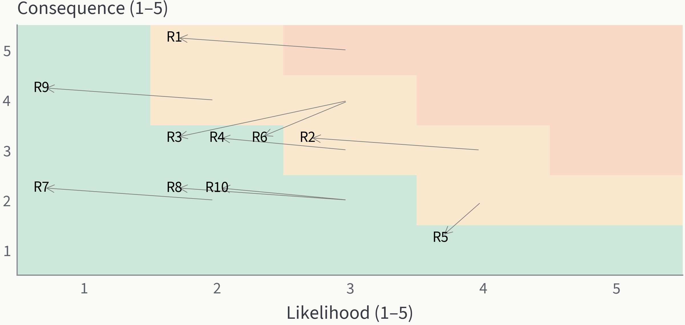

**F5.** *Mitigations move every risk at least one cell down or left.* Likelihood × consequence before (arrow tail)
and after (label); register in `aerokit.venus.risk`.

| ID | Risk | L×C → after | Mitigation (evidence in `risk.py`) |
|---|---|---|---|
| R1 | mid-air deployment fails | 15 → 10 | spin up on the bridle; spring hinges with latches; Earth balloon-drop tests at 1–2 km (density match, Izraelevitz 2025 [D-ag]) |
| R2 | night falls before goals are met | 12 → 9 | release at the morning hour angle where the array first covers loiter (−51°); science early; sunset dive; hybrid option |
| R3 | acid degradation | 12 → 6 | FEP/PFA on every wetted surface, Parylene cells, sealed motor-gearbox cans; acid qualification of wrapped CFRP |
| R6 | slow large rotors, flap dynamics | 12 → 6 | collective actuators for attitude, stiff blades (1.7/rev), simulator control tests |
| R4 | battery overheats in dives | 9 → 6 | diode heat pipe, 51 km floor for dives (57 °C peak), abort at 50 °C at depth, PCM option |
| R9 | entry loads on the folded structure | 8 → 4 | shallow corridor, locked arms, 100 g qualification |
| R5, R7, R8, R10 | downdrafts, comms gaps, nav drift, atmosphere uncertainty | ≤ 8 → ≤ 4 | ride downdrafts; store-and-forward; air-frame nav + Doppler; size on the thin case |

**Open technical challenges**: (1) folding an 8 m-span hexacopter with 2.6 m rotors into a 3.7 m shell and unfolding
it at 69 km (NASA Ames 2026 calls folding/deployment the biggest challenge for above-cloud Venus aircraft [D-ag]); (2) aeroelasticity of slender, slow
blades (aspect ratio ~21, 1.7/rev) during spin-up in the parachute wake; (3) CFRP + FEP in concentrated acid for days;
(4) sealed motor-gearbox cans (lubrication, seal life) in acid aerosol; (5) 100 g qualification of a folded
rotorcraft; (6) the entry-load discrepancy above; (7) relay-orbit capture cost; (8) night survival — only with
buoyancy (§8).

**How we would retire the top risks (verification plan) [Y]**: (1) *deployment* — Earth balloon drops of a scale
VESPER at 1–2 km altitude, where the air density equals Venus at 54–55 km (the JPL aerobot prototype flew at exactly
this match in 2022 [D-ag]), with spin-up on the bridle and release; (2) *rotor* — whirl test of one 2.6 m rotor in a
CO₂-filled chamber at 0.5 bar, 300 K (the Mars Helicopter's 2016 prototype and its engineering development model were tested in CO₂ at 0.0175 kg/m³ in
JPL's 25-ft Space Simulator — Balaram 2018 p.2 [D]) to
replace the BEMT power factor with a measurement; (3) *acid* — 96 % H₂SO₄ exposure of FEP-wrapped CFRP blade coupons
and sealed motor cans (JPL's 100 °C protocol [D-ag]); (4) *thermal* — vessel + heat-pipe diode in a CO₂ chamber through
the 55 → 51 → 55 km dive profile; (5) *flight software* — the whole CONOPS in a Liftoff-Core-style simulator fed by
`outputs/vesper_for_simulator.json` — the part LuGus already does for Mars.

### 7.1 Independent cross-checks of the headline numbers [K]

`python 04_Venus/scripts/venus_crosscheck.py` re-derives the three headline numbers without BEMT, without the mass closure
and without the simulator (→ `outputs/crosscheck.json`, `.md`):

| Quantity | Main method | Simple method | Spread |
|---|---|---|---|
| Hover electric power at 55 km | BEMT 2088 W (FM 0.60) | momentum theory, FM 0.55–0.75, thin–dense air: 1676–2315 W | -20 … +11 % |
| Gross mass | closed budget 43.7 kg | MSH payload fraction 11–16 % → 19–26 kg Mars-like, +6.7 kg Venus-only items → 25–33 kg | -42 … -25 % |
| Sun threshold cos z | code 0.595 | closed form 0.595 | -0.0 % |
| Flight time | simulation 49.2 h | window 45.8 h + battery 0.8 h = 46.5 h | -5 % |
| Solar energy margin in the window | — | 108 kWh in / 61 kWh needed = 1.77× | — |
| Whole air-mass day | — | daylight array energy 127 kWh vs 206 kWh to loiter all 154 h | 0.62× |

- **Hover power agrees.** Ideal momentum power divided by a measured figure-of-merit range (0.55–0.75: Knight & Hefner,
  Harrington, Ingenuity chamber [D-ag]) brackets the BEMT value; BEMT's own FM is 0.60. The spread (−20…+11 %) is the
  FM range plus the probe density envelope, not a model disagreement.
- **Mass: the closed budget is 25–42 % heavier than a top-down estimate**, and that is expected. The estimate scales
  the Mars Science Helicopter payload fraction (2.02/17.69 = 11.4 %; 5/31.2 = 16.0 % [D-ag]) to our 3 kg and adds
  the Venus-only solar deck, coating and thermal parts (6.7 kg with contingency). It still leaves out three things the
  budget carries: the titanium vessel (3.2 kg), the 2.7 m folding arms that 2.6 m rotors need (7.7 kg; MSH rotors
  are R 0.64 m [D-ag]), and a 1.04 kWh battery sized for a 0.5 h hover reserve at 2.1 kW. VESPER's payload fraction is
  6.9 %. This is the price of large slow rotors and a sealed vessel. A top-down estimate does not show it, so the
  mass is driven by the arms and the vessel, not by the rotors' power.
- **Solar margin agrees.** The closed-form sun threshold (cos z = 0.595) matches the code exactly. The hand flight
  time (sunlit window + battery tail = 46.5 h) is 5 % below the simulated 49.2 h; I have not split that 2.7 h
  difference into its causes. In the sunlit window the array delivers 1.77× the loiter energy. Over a whole air-mass
  day it delivers only 0.62× of what loitering through the night would need, so a battery cannot carry it through
  the night (§6.2).

### 7.2 Jury questions — the ten most damaging, with our answers

A fresh agent read this document cold as a hostile LuGus/planetary-science jury and ranked the questions that hurt
most (`04_Venus/research/R_jury_questions_2026-11-04.md`). I re-ran the numbers in answers 1 and 5
myself (`D:/tmp_ideathon/venus/r5/my_checks.py`, `windmill.py`); the rest cite this document and its notes. Where the
answer is "we have not done it", we say so.

1. **"42 % of your solar power comes from the back of the panel. Do flight triple-junction cells even have a
   transparent back?"** — This is our largest assumption.
   - Rear share = r·b / (1 + r·b) = 0.42, with r = 0.86 the PV up/down flux ratio [D] and b = 0.85 the bifaciality [Y].
   - Same closed form as §7.1, with less rear light: b = 0.5 → sunlit window 40.6 h; **b = 0 → 26.7 h, and hover never
     runs on sunlight** (1.71 kW overhead vs 2.09 kW). Getting the same power from one face needs 7.7 m² of deck,
     which does not fit between the rotors.
   - Landis & Haag exclude the up-welling light [D-ag]. I have not checked whether bifacial III-V flight cells exist.
   - Answer: with single-sided cells VESPER still flies a ~27 h sunlit window. The bifacial deck is a technology bet,
     listed in the soft spots and not counted in the baseline claims.
2. **"Balloons already stay up for months between 52 and 62 km. Why a 49 h rotorcraft?"** — The rehearsed line
   "balloons cannot control altitude" was wrong. The JPL/Aerostar variable-altitude aerobot design covers 52–62 km with
   a 117-day goal [D-ag]. On duration, a balloon beats a pure rotorcraft.
   - What a rotorcraft adds is *fast* control: a 51 km dive and back in 0.45 h, station on a cloud feature in the
     air-mass frame, and climbing out of a downdraft on demand.
   - The 3 kg payload (nephelometer, aerosol mass spectrometer, T/p/wind/turbulence sensors, camera; `design.json`
     [Y]) is chosen for that kind of sampling.
   - This is why the helium hybrid (§8) is our long-duration answer.
3. **"Your entry model is 'conservative' in g. What about heating, and what is the heat shield?"** — Our 246 W/cm²
   and 3.9 kJ/cm² sit below the ADEPT envelope of 350–400 W/cm² [D-ag].
   - §5.1 shows our heating can be up to ~30 % low for small cones, so we design to ×1.5, i.e. ~370 W/cm².
   - The heat-shield mass is a historical fraction (Landis: TPS 13 % + 8 % of entry mass), not a sizing.
   - Material: HEEET, tested to ~6000 W/cm² and 5 atm [D-ag], far above our case. TPS thickness sizing is an open
     item.
4. **"More than 30 unfolding steps in mid-air. Has anything like that ever worked?"** — No. Only 2–4-fold aircraft
   have been demonstrated [D-ag].
   - There is no structural check of the stowed vehicle at 56 g; "qualify to 100 g" is a test requirement, not a
     computed margin.
   - Retiring this is the first item of the verification plan: Earth balloon drops at the density match.
5. **"At 'flat pitch' in a 12.8 m/s descent the rotors windmill and pull on the bridle. How hard?"** — The jury is
   right. The doc said "no thrust", and this is now corrected.
   - The descent sets a 13.7° inflow angle at 0.75 R (52.5 m/s blade speed).
   - At θ = 0 a hand blade-element estimate gives about **1.2 × the vehicle weight** on the bridle, stall limited
     (cl 1.3, ρ 0.28 kg/m³ at 63 km). Our BEMT gives only 0.11 W there, because it is built and validated for hover
     and climb, not descent.
   - So spin-up must happen at the **zero-lift collective, ≈ −16° at 0.75 R** (−13.7° inflow, −2° section zero-lift
     angle). The collective actuators need a range of about −16…+15°.
   - The §5.3 pull-out model (thrust ramp in time, vortex ring as ×0.8 thrust [Y]) is an assumption, not rotor
     physics.
6. **"You show FEP acid data. What about the CFRP, the hinges and the rotating seals?"** — FEP: 168 h in concentrated
   H₂SO₄ at 120 °C, 0 % weight gain [D-ag]. Parylene-coated cells: no loss after 96 h in 96 % acid [D-ag].
   - Wrapped CFRP, PFA-coated Ti hinges and the PTFE shaft seal have **no Venus-acid data** (open challenges 3–4).
   - The 3.4× margin covers the FEP skin only; the margin table now says so.
7. **"A downdraft hits during your 51 km dive."** — We had treated the two hazards separately.
   - Riding a VEGA-2 downdraft (~2.9 km [D-ag]) from 51 km would take the vehicle near 48 km, where the battery
     passes 60 °C (§4.6).
   - Holding against it costs +1.4 kW (§4.7) on top of the higher demand at 51 km. Most of that comes from the 1.04
     kWh battery unless the Sun is high.
   - Rule: **dive only when the array covers hover (cos z ≥ 0.80), and abort the dive and climb at once when a
     downdraft is detected.**
   - We have not run the combination in the simulator; it is §6.1 scenarios 2 and 3 together.
8. **"Where is the mass of the six collective actuators, the blade-fold hinges and the petal mechanisms?"** — They
   are not itemised; they sit in the 20 % contingency (7.3 kg) [Y].
   - If they were extra, growth is steep: +2 kg payload → 48.6 kg and 46.2 h (`sensitivity.json`), i.e. ~2.5 kg of
     gross mass and ~1.5 h of flight per added kg.
9. **"Which relay orbit, and who pays for capture?"** — The link model assumes an overhead pass on every orbit
   (`aerokit.venus.link`).
   - That needs a near-equatorial orbit matched to the release latitude. The super-rotation is zonal, so VESPER stays
     at its latitude.
   - Polar-orbit geometry and the carrier's capture Δv are not computed; both are open items.
10. **"One rotor fails. Can an alternating-spin hexacopter still control yaw?"** — We modelled the thrust only:
    1.6 × 5/6 = 1.33 × weight. Controllability after each single failure is **not analysed**.
    - Per-rotor collective, reversible to −16° (answer 5), gives each rotor independent thrust and torque control,
      which fixed-pitch hexacopters lack. Whether that is enough is a simulator test, using the `motor out` failure
      mode in `sim_params.json`.

Smaller points fixed:
- Risk R2 said "release near noon"; the baseline releases at hour angle −51° (16.6 h after dawn), and the table now
  says so.
- The rehearsed balloon line in §9 is corrected as in answer 2.
- VESPER's rotor section is an assumed airfoil [Y]; the BEMT validation used each test report's own section.

## 8. Alternative (needs mentor approval): VESPER-H, helium-assisted [K]

The brief says *rotorcraft*; a balloon-assisted hybrid is offered only if the mentor accepts it. A superpressure
helium cell that floats the whole 43.7 kg vehicle at 55 km is a 5.7 m sphere (94 m³; 20 kg of envelope at 0.2 kg/m²
[Y], VEGA heritage 0.33 kg/m² [K from D-ag]); add 12.6 kg of battery for a 78 h (rounded up from 77 h), 25 W night "sleep" and ~62 kg of
helium tanks dropped after inflation. Rotors then only drive altitude excursions; the mission becomes weeks–months
(helium leakage and acid ageing), not hours. Precedent: VEGA floated 21 kg on a 3.4–3.5 m sphere for 46 h [D-ag]; our
lift model gives a 3–4 m sphere for VEGA's numbers (test).

## 9. Friday 6-hour plan [Y]

| Time | Output |
|---|---|
| 0:00–0:30 | Confirm the brief with the mentor (questions §10); one-sentence claim; open `design.json` and the visual |
| 0:30–1:30 | Q1 slide: F1 + table §3 + why 55 km (battery window, power, mass, latitude) |
| 1:30–3:00 | Q2 slides: configuration table, rotor numbers + F8 validation, geared drive, power (F2), thermal, materials, control/nav, comms, structure, F4 |
| 3:00–4:00 | Q3 slides: transfer → entry (F3) → chute → spin-up → release (26 m vs 559 m); deployment strip from the visual |
| 4:00–5:00 | Mission F6, risks F5, sensitivity F9/F10, honest feasibility, hybrid alternative |
| 5:00–6:00 | Rerun with any mentor numbers — `python 04_Venus/scripts/venus_day.py --final --payload-kg 5 --cruise-km 56 --rotor-d 2.3` (~2 min; writes `out_variant_*/` and `design_variant_*.json`, never touching the baseline hand-off); consistency and units check; rehearse |

One-line answers to rehearse: *why rotors on Venus?* — at 55 km a rotor works as on Earth (Re ~1.7×10⁵, ~48 W/kg), and it
controls altitude and position *fast* (a 51 km dive and back in 0.45 h); variable-altitude balloons last longer (§7.2-2). *Wind 65 m/s?* — we fly in the air mass; ground position is irrelevant to
survival. *Night?* — a pure rotorcraft cannot; it lives one 49 h air-mass day; with mentor approval, a helium cell makes
it months. *Acid?* — FEP/PFA on every wetted surface (FEP: 0 % weight gain at 120 °C [D-ag]; PFA by analogy [Y]). *How do you know the rotor
numbers?* — BEMT validated against two NACA tests (rms 6 %). *Biggest weakness?* — mass growth; the geared drive is
what makes the design robust, and a 1 h no-sun reserve still does not close.

## 10. Questions for the mentor
1. Is a buoyancy-assisted hybrid acceptable, or strictly rotorcraft? (decides §8)
2. Mission duration target — one day-side pass (hours) or long-duration?
3. Any mass/aeroshell/payload cap or launch-vehicle assumption?
4. Is a relay orbiter given, or must the concept include it?
5. Should the visual show the deployment sequence (we have altitudes/times) or just the vehicle?
6. Level of numbers expected: conceptual sizing (ours) or simulation-ready parameters for Liftoff/Unity
   (`vesper_for_simulator.json`)?
7. Is a given atmosphere model expected (VIRA)? We use Pioneer Venus probe data with bands.

## 11. Reproduce

```bash
export TEMP=D:/tmp_ideathon/venus TMP=D:/tmp_ideathon/venus MPLCONFIGDIR=D:/tmp_ideathon/venus/mpl PYTHONPATH=src PYTHONIOENCODING=utf-8
python -I 04_Venus/scripts/venus_pds_extract.py D:/tmp_ideathon/venus/downloads/atmo   # PDS -> pv_profiles.json (already in repo)
python 04_Venus/scripts/venus_trade.py            # 72-design trade, ~2 min
python 04_Venus/scripts/venus_entry_validation.py # 12 historical entries + DAVINCI, ~1 min (also run by --final)
python 04_Venus/scripts/venus_sensitivity.py      # one-at-a-time + robustness (39 closed designs re-flown), ~10 min
python 04_Venus/scripts/venus_day.py --final      # numbers, F1-F15 (datawiz audit), design.json, simulator file
python 04_Venus/scripts/venus_crosscheck.py       # headline numbers by simpler methods (§7.1)
python 04_Venus/scripts/venus_sim_params.py       # sim_params.json for the LuGus simulator
python 04_Venus/scripts/venus_day.py --final --payload-kg 5 --cruise-km 56   # what-if with mentor numbers -> out_variant_*/
python -m pytest -q -p no:cacheprovider tests/test_venus_bemt.py tests/test_venus_entry.py tests/test_venus_atmosphere.py tests/test_venus_system.py
```

Code: `src/aerokit/venus/` (`gas`, `atmosphere`, `entry`, `descent`, `bemt`, `performance`, `power`, `thermal`,
`structure`, `sizing`, `link`, `navigation`, `control`, `materials`, `hybrid`, `risk`, `design`),
`src/aerokit/venus_flight.py` (`simulate_rotorcraft_day` added; the helium-cell simulator of doc 19 unchanged).
References: `src/aerokit/references/_task_venus2.py` → `00_Common/docs/references.md`. Environment: no new packages (numpy,
scipy, matplotlib, datawiz already present). CLI interface-gate audit of the `--final` output:
`04_Venus/outputs/cli_yasa_denetimi.md`.

Figures: `04_Venus/outputs/F1…F15.{png,pdf}` with datawiz audits `*.denetim.txt` (0 HATA each) and set
consistency `vesper.tutarlilik.txt` (0 HATA).
