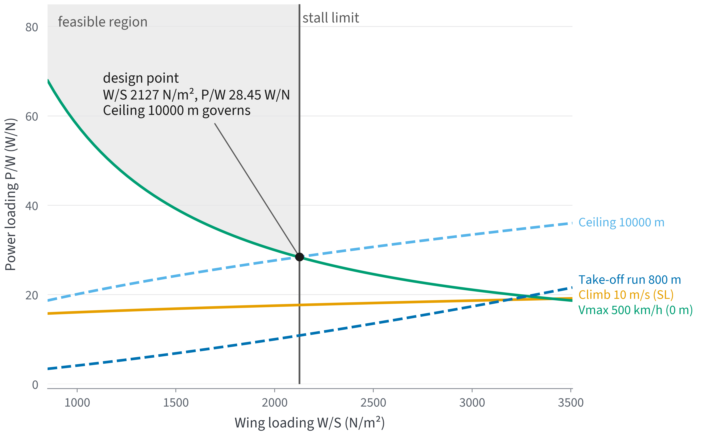
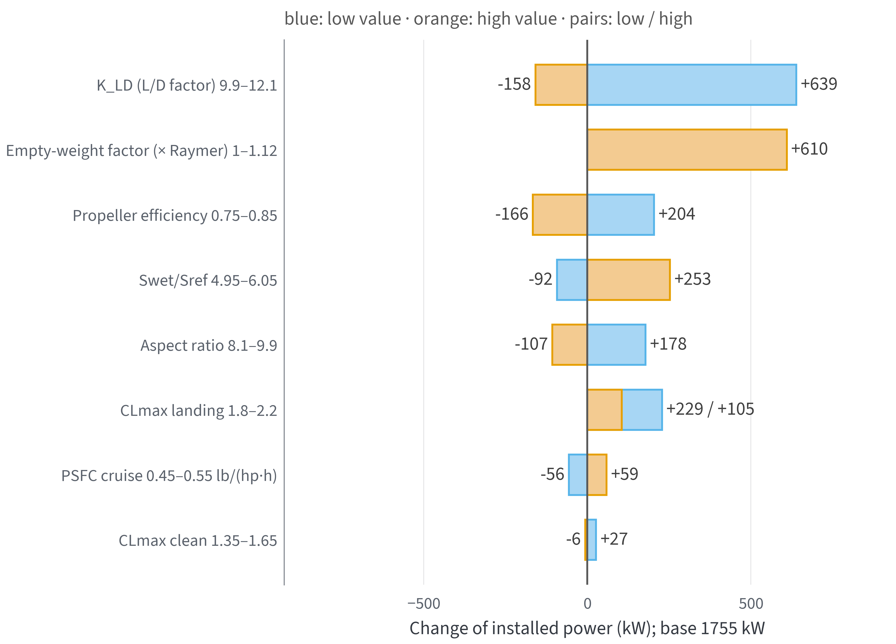
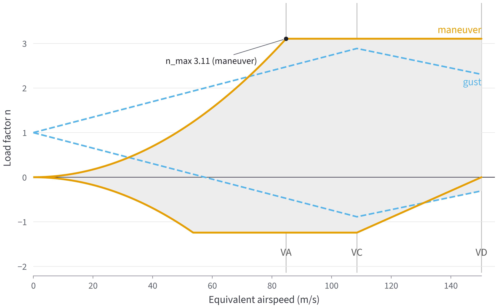
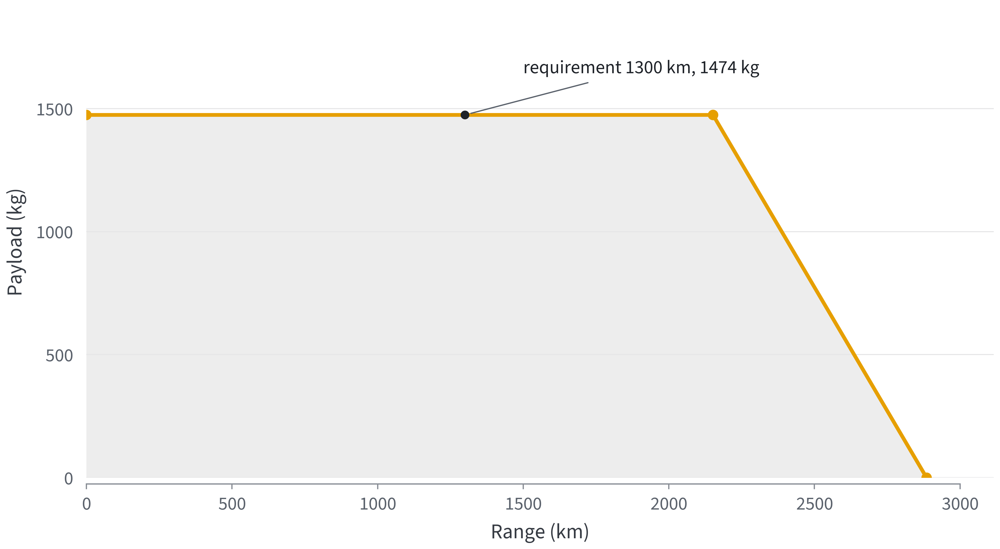

## Conceptual design — Ansys 2023 crisis-response aircraft

**Requirements (as given, and as parsed by the unit layer)**

| Requirement | As given | Read as |
|:---|---:|---:|
| range | 1300 km | 1 300 km |
| loiter | 30 min | 30.0 min |
| stall_speed | 150 km/h | 150 km/h |
| max_speed | 500 km/h | 500 km/h |
| max_speed_altitude | 0 m | 0.0 m |
| service_ceiling | 10000 m | 10 000 m |
| rate_of_climb | 10 m/s | 10.0 m/s |
| takeoff_ground_roll | 800 m | 800 m |
| crew | 4 | 4 |
| passengers | 10 | 10 |
| person_mass | 91 kg | 91.0 kg |
| cargo_mass | 200 kg | 200 kg |

**Constraint diagram at the stall-limited wing loading**

| Constraint | P/W at design W/S (W/N) | Power (kW) |
|:---|---:|---:|
| Climb 10 m/s (SL) | 17.70 | 1091 |
| Ceiling 10000 m | 28.45 | 1755 |
| Vmax 500 km/h (0 m) | 28.38 | 1750 |
| Take-off run 800 m | 10.88 | 671 |

**Sized design**

| Quantity | Value |
|:---|:---|
| Take-off mass W0 | 6288 kg |
| Wing area S | 29.00 m² |
| Wing loading W/S | 2127 N/m² (stall limit) |
| W/S limits | stall 2127 N/m² |
| Installed power (SL) | 1755 kW |
| Governing constraint | Ceiling 10000 m |
| Fuel fraction Wf/W0 | 0.156 |
| Empty-weight fraction We/W0 | 0.610 (engine-mass correction +0.0138, power_weight_coupling on) |
| L/Dmax · CD0 · e | 14.1 · 0.0280 · 0.783 |
| Payload | 1474 kg |
| Mission weight fraction | 0.8530 |

**Planform and loads**

| Quantity | Value |
|:---|:---|
| Span b | 16.154 m |
| Root chord | 2.393 m |
| Tip chord | 1.197 m |
| Mean aerodynamic chord | 1.861 m |
| Spanwise MAC position | 3.590 m |
| CLα (lifting line, Anderson Eq. 5.69) | 5.141 1/rad |
| n_max · n_min | 3.11 · -1.24 |

**Requirement compliance of the sized design (point performance)**

| Requirement | Required | Achieved | Margin | Pass | Note |
|:---|---:|---:|---:|:---|:---|
| range | 1 300 km | 2 036 km | +56.6 % | yes | [1] |
| loiter | 30.0 min | 217 min | +624.0 % | yes | [2] |
| stall_speed | 150 km/h | 150 km/h | 0.0 % | yes | [3] |
| max_speed | 500 km/h | 500 km/h | +0.1 % | yes | [4] |
| service_ceiling | 10 000 m | 10 000 m | 0.0 % | yes | [5] |
| rate_of_climb | 10.0 m/s | 18.6 m/s | +86.1 % | yes | [6] |
| takeoff_ground_roll | 800 m | 278 m | +65.2 % | yes | [7] |
| payload | 1 474 kg | 1 474 kg | 0.0 % | yes | [8] |

[1] one mission from W0: cruise at the best-range speed (h = 3000 m) then loiter at the best-endurance speed (h = 3000 m) on (1 - 0.06)*W_fuel (reserve 0.06); numerical dW/dt integral; no take-off/climb/descent fuel

[2] one mission from W0: cruise at the best-range speed (h = 3000 m) then loiter at the best-endurance speed (h = 3000 m) on (1 - 0.06)*W_fuel (reserve 0.06); numerical dW/dt integral; no take-off/climb/descent fuel

[3] 1-g stall at sea level, W0, CLmax = 2

[4] largest V with P_A = P_R at h = 0 m, W0 (no compressibility)

[5] altitude of max ROC = 0.508 m/s at W0 (root finding, 0-20 km) (on the sizing constraint, |margin| < 1e-5)

[6] max steady ROC (P_A - P_R)/W at h = 0 m, W0

[7] ground roll to V_LOF = 1.1 V_stall,TO (CLmax 1.7, mu 0.03), forces at 0.7 V_LOF, h = 0 m, W0

[8] W0 - W_empty - W_fuel (on the sizing constraint, |margin| < 1e-5)

**One-at-a-time sensitivity (sorted by power swing)**

| Assumption (low–high) | W0 low / high (kg) | Power low / high (kW) | Governing low / high |
|:---|:---|:---|:---|
| K_LD (L/D factor) 9.9–12.1 | 7034 / 6000 | 2394 / 1596 | Vmax 500 km/h (0 m) / Ceiling 10000 m |
| Empty-weight factor (× Raymer) 1–1.12 | 6288 / 8473 | 1755 / 2364 | Ceiling 10000 m / Ceiling 10000 m |
| Propeller efficiency 0.75–0.85 | 6581 / 6049 | 1959 / 1589 | Ceiling 10000 m / Ceiling 10000 m |
| Swet/Sref 4.95–6.05 | 6122 / 6588 | 1662 / 2007 | Ceiling 10000 m / Vmax 500 km/h (0 m) |
| Aspect ratio 8.1–9.9 | 6535 / 6118 | 1933 / 1648 | Ceiling 10000 m / Vmax 500 km/h (0 m) |
| CLmax landing 1.8–2.2 | 6477 / 6375 | 1984 / 1860 | Vmax 500 km/h (0 m) / Ceiling 10000 m |
| PSFC cruise 0.45–0.55 lb/(hp·h) | 6087 / 6500 | 1699 / 1814 | Ceiling 10000 m / Ceiling 10000 m |
| CLmax clean 1.35–1.65 | 6310 / 6283 | 1782 / 1748 | Ceiling 10000 m / Vmax 500 km/h (0 m) |
| Engine specific power 3.18–3.88 kW/kg | 6325 / 6258 | 1765 / 1746 | Ceiling 10000 m / Ceiling 10000 m |
| PSFC loiter 0.54–0.66 lb/(hp·h) | 6261 / 6316 | 1747 / 1762 | Ceiling 10000 m / Ceiling 10000 m |
| Loiter speed 225–275 km/h | 6261 / 6316 | 1747 / 1762 | Ceiling 10000 m / Ceiling 10000 m |
| Power lapse exponent n (σⁿ) 0.7–1 | 6283 / 6288 | 1748 / 1755 | Vmax 500 km/h (0 m) / Ceiling 10000 m |

**Assumptions**

| Assumption | Value | Source |
|:---|:---|:---|
| aircraft_type | twin turboprop | Raymer Table 3.1 class (assumption) |
| aspect_ratio | 9.0 | assumption; comparable: C-212 AR 10, CN-235 AR 11.27 |
| K_LD | 11.0 | Raymer K_LD for retractable-gear propeller aircraft (via CSV, not read) |
| wetted_area_ratio | 5.5 | assumption |
| propeller_efficiency | 0.8 | Raymer Table 3.4 (search summary) |
| takeoff_propeller_efficiency | 0.6 | assumption |
| psfc_cruise | 0.5 lb/(hp*h) | turboprop, METU AE172 lecture 5 |
| psfc_loiter | 0.6 lb/(hp*h) | turboprop, METU AE172 lecture 5 |
| loiter_speed | 250 km/h | assumption |
| CLmax_clean | 1.5 | choice within Scholz Table 5.1 range 1.2-1.8 |
| CLmax_takeoff | 1.7 | choice within Scholz Table 5.1 range 1.4-2.0 |
| CLmax_landing | 2.0 | choice within Scholz Table 5.1 range 1.6-2.5 |
| power_lapse | sigma | assumption P/P_SL = σ (most sensitive, docs/04 §1) |
| power_lapse_n | 1.0 | exponent for power_lapse = 'sigma^n' |
| rolling_friction | 0.03 | assumption, paved runway |
| taper_ratio | 0.5 | assumption |
| drag_method | kld | kld = L/Dmax from K_LD·√(AR/(Swet/Sref)); buildup = component build-up |
| CD0_override | 0.0 | 0 = not used; > 0 replaces the K_LD-derived CD0 |
| e_override | 0.0 | 0 = not used; > 0 replaces the Raymer Oswald e |
| cruise_altitude | 3000 m | assumption (drag build-up Reynolds number) |
| empty_weight_factor | 1.0 | multiplier on Raymer We/W0; King Air 350i calibration 1.118 (aerokit.design.validation) |
| wing_loading | max | max = largest W/S allowed by stall and landing (smallest wing); min_power = W/S of the lowest governing P/W below that limit |
| power_weight_coupling | on | on = engine mass follows the installed power relative to the class reference (design.sizing.CLASS_POWER_REFERENCE); off = Raymer We/W0 only, reproduces docs/04 |
| engine_specific_power | 3.53 kW/kg | PT6A-60A 780 kW / 221 kg dry (Wikipedia PT6, read 2026-10-25); dry engine, no nacelle or propeller |

Figures: , , , 

**Result:** W0 ≈ 6288 kg, S ≈ 29.0 m², P ≈ 1755 kW (Ceiling 10000 m governs); 8/8 requirements met.

**Next step:** Replace the K_LD guess with the drag build-up (largest sensitivity), then plan the mission.
