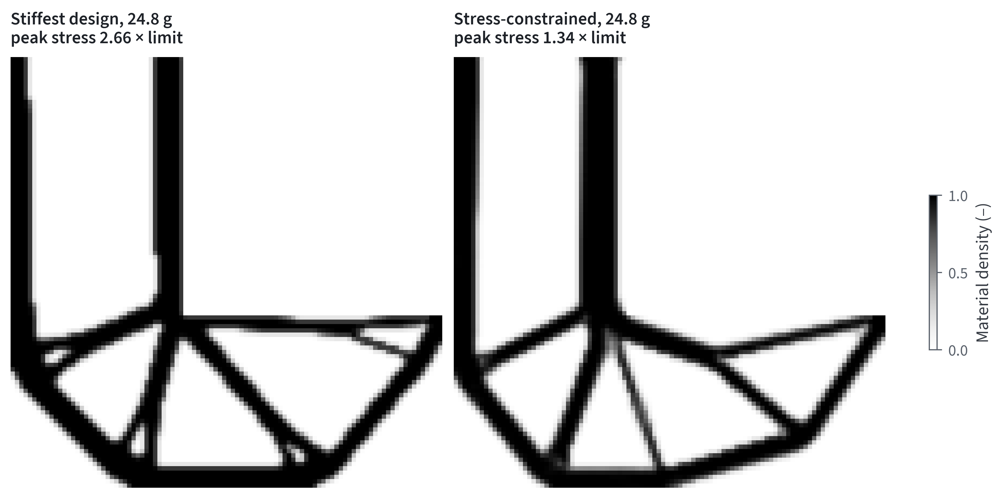
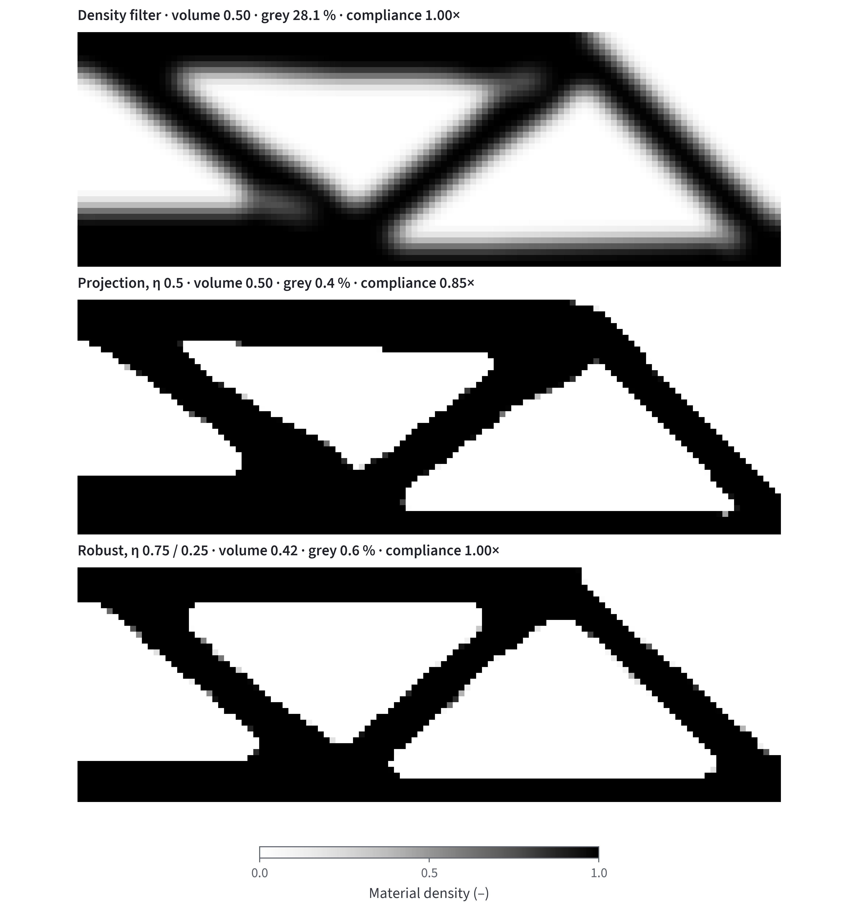

# 16 — Topology optimisation methods and settings catalogue

Team Beetiful, EUROAVIA Ideathon 2026 (Ansys challenge). Written 3 Nov 2026. Covers what to set, what to expect and how to check a topology result in Ansys Mechanical/Discovery and in our own code (`src/aerokit/optimization/`).

**Tags.**
- **[D]**: read in the primary source on 2–3 Nov 2026. The page or equation number is given.
- **[S]**: read in a secondary source, which is named.
- **[Y]**: our own judgement or arithmetic.
- **[R]**: computed in this repository. The script or test is named.

Source pack with the access log: `research_notes/Optimizasyon kaynakları/TO_kaynak_paketi.md`.

The Ansys defaults below are from the **Structural Optimization Guide 2025 R1**. Discovery's help was not found. Check every default on screen on 5 Nov.

## 1. Which method for which task

| Task wording on the day | Method | Ansys | Our code (preview) | Section |
|---|---|---|---|---|
| "minimise mass / keep X % / stiffest part" | SIMP compliance with a volume or mass target | Topology Density or Mixable Density; Response Constraint Mass, Percent to Retain | `topology.topopt`, `topo_mapped.topopt_mapped` | §3.1 |
| "crisp, printable, minimum wall/strut size" | projection plus robust (eroded/dilated) design | Member Size (Minimum = 2.5 × element by default) | `projection.topopt_projected(robust=0.25)` | §3.2–3.3 |
| "must not exceed yield / stress limit" | minimum mass under clustered P-norm stress | Local von Mises Stress constraint (density-based only), Convergence Accuracy 0.05 % | `stress_topo.topopt_stress` | §3.4 |
| "printed without supports / build direction" | AM overhang filter | AM Overhang Constraint, 45° default, 27–60° | `am_filter.AMFilter2D` in `topopt_mapped(am=...)` | §3.5 |
| "avoid resonance / f₁ ≥ ... Hz" | eigenfrequency objective or constraint | Natural Frequency response (no OC solver for modal) | not implemented (check f₁ with `design.card_physics.modal`) | §3.6 |
| "symmetric part / machined with one pull" | design-variable maps | Symmetry tool, Pull-out / Extrusion constraint | `topo_mapped.group_map(mirror=, extrude=)` | §3.7 |
| "give us the CAD" | iso-surface → STL/DXF, then re-analyse | Smoothing object (STL), Design Validation system | `extract.surface_nets`, `extract.to_dxf` | §5 |

## 2. Settings card: Ansys default, paper default, our default

| Setting | Ansys Mechanical 2025 R1 [D] | Paper | Our code |
|---|---|---|---|
| Optimisation type | **Mixable Density** (default); Density Based listed separately | — | density-based SIMP |
| Stiffness penalty p | 3 ("Pseudo Density^Penalty") | 3 (top88, Holmberg q = 3) [D] | 3 |
| Minimum normalised density | 0.001 | E_min = 1e-9·E₀ (top88) [D] | E_min = 1e-9·E₀ |
| Filter | Non-linear (Program Controlled) or Linear; density-based only | density filter, cone weights (top88 Eq. 8–9) [D] | density filter (`ft=2`) |
| Minimum member size | Program Controlled = 2.5 × element size (density-based) | b = R at η_e = 0.75 (Qian & Sigmund Eq. 29) [D] | `projection.radius_for_member` |
| Optimiser | SCP (MMA-type); OC only for compliance + volume/mass | OC (top88), MMA (Holmberg) [D] | OC; MMA with m constraints (`stress_topo.mma_multi`) |
| Maximum iterations | 500 | 2500 (top99neo Table 2) [D] | 1000 (`topopt`) |
| Convergence | relative objective change ≤ 0.1 % on 3 successive iterations; 0.05 % advised with stress constraints | max\|Δx\| ≤ 0.01 (top88); ‖Δx̂‖/√m ≤ 1e-6 (top99neo) [D] | max\|Δx\| ≤ 0.01 |
| Mass target | Percent to Retain 50 % (equality for density-based) | V* = 0.5 (MBB tests) | `volume=` argument |
| Retained threshold (result) | 0.5 (0.01–0.99); bands Remove 0–0.4, Marginal 0.4–0.6, Keep > 0.6 | — | 0.5 in `extract.mass_preserving_level` |
| AM overhang | build +Z, 45°, keep 27–60° (density-based) | ε = 1e-4, P = 40, ξ₀ = 0.5, OC move 0.05 (Langelaar 2017 p. 875) [D] | P = 40, ε = 1e-4 since 3 Nov (was 80 / 1e-3) |
| Stress P-norm | clusters; current release uses Le's adaptive factor c_i | p = 8, η_S = ρ^½, 10 clusters (Holmberg) [D] | p = 8, ρ^½, 10 clusters, stress-level reclustering every iteration |

Le's update formula for c_i was not found, so our code uses Holmberg's fixed 1/N_i form. Expect Ansys's reported maximum stress to sit closer to the limit than ours does [Y].

## 3. Methods

### 3.1 SIMP with a density filter (top88)

- **Model [D]:**
  - Modulus: E_e = E_min + x̃_e^p (E₀ − E_min).
  - Filtered density: x̃ = Hx / Hs, with H_ei = max(0, r_min − Δ(e,i)).
  - Update: OC with damping ½ and move 0.2. The volume is evaluated on x̃.
- **Reproduced [R]:** `tests/optimization/test_topology.py` matches the top88 printed compliances to ±0.005 on the MBB 60 × 20 at V = 0.5:
  - Sensitivity filter: 216.81.
  - Density filter: 233.71.
  - Heaviside, r_min 1.8: 189.14.
- **Paper typos to ignore [D]:**
  - The second OC condition in Eq. (3) prints "x_e − m"; the code uses x_e + m.
  - §3.4 prints r_min "2.4, 6 and 16", but 0.04 × 300 = 12.
- **Pitfalls:**
  - Report x̃, never x [D].
  - With the density filter, dv is not uniform, so it must stay in the OC update [D].
  - The sensitivity filter's gradient is not the true gradient [D].

### 3.2 Threshold projection and the volume-preserving threshold (top99neo)

- **Projection [D]:** x̂ = (tanh βη + tanh β(x̃ − η)) / (tanh βη + tanh β(1 − η)), with ∂x̂/∂x̃ from Eq. (9).
  - η = 0.5 alone gives **no** length scale on either phase (Qian & Sigmund, Fig. 2) [D].
- **Volume-preserving threshold [D]:**
  - η* solves V(x̂(η*)) = V(x̃) (Eq. 17), by Newton from the previous η.
  - The paper finds η* ∈ [0.4, 0.52].
  - Our code adds ∂η*/∂x̃ to the gradient. That derivation is ours, and the finite-difference test passes [R].
- **Continuation:**
  - top99neo's default call has none. With penal = 3 and β = 2 as inputs, maxPar is already reached [D, read from the listing logic].
  - To get continuation, start p at 1 and β at 1 (Table 2, T3).
- **Filter boundary [D]:**
  - The zero-Neumann (mirrored) filter gave c = 3993.7 on the 3-D cantilever; zero-Dirichlet gave 4074.3.
  - Our filter is the Dirichlet type, like top88, so expect a slightly worse local minimum near the edges.
- **Our call:** `projection.topopt_projected(problem, V, rmin, eta=0.5, volume_preserving=True)`.

### 3.3 Robust design and the minimum member size

- **Realisations [D, Qian & Sigmund p. 8]:** eroded, blueprint and dilated thresholds 1 − η, 0.5 and η, with η ∈ [0, 0.5].
  - β starts at 1 and doubles every 50 iterations up to 128.
  - The volume constraint is on the dilated design.
  - The objective is max{J_e, J_d} (Lazarov et al. 2016, Eq. 37) [D].
- **Size rule [D, Eq. 29]:** b/R = 2√(η_e − ½) for η_e ∈ [0.5, 0.75], and 2 − 2√(1 − η_e) for η_e ∈ [0.75, 1].
  - Assumptions: 1-D, a hat filter, and the same topology in every realisation.
  - The prediction matched computed widths within 1–1.6 % (their Tables 1–2).

| Dilated η | η_e = 1 − η | b/R |
|---|---|---|
| 0.40 | 0.60 | 0.63 |
| 0.30 | 0.70 | 0.89 |
| **0.25** | **0.75** | **1.00** |
| 0.20 | 0.80 | 1.11 |
| 0.10 | 0.90 | 1.37 |

- **Day-of recipe [Y]:**
  1. Choose the minimum strut b from the process. Example: the AM minimum thickness in docs/12 is ≥ 1.27 mm and ≥ 3 voxels.
  2. With η = 0.25, set r_min = b / h elements. `projection.radius_for_member(b, h)` returns it.
  3. Keep r_min at least 3 elements, so the mesh is h ≤ b/3.
  4. In Ansys, the Program Controlled minimum member size is 2.5 elements. To force b, set Member Size → Minimum = b manually.

### 3.4 Stress-constrained topology (Holmberg et al. 2013)

- **Problem (P1) [D]:** minimum mass subject to σ_i^PN = ((1/N_i) Σ_{a∈Ω_i} (σ_a^vM/σ̄)^p)^{1/p} ≤ 1 for each cluster i.
- **Settings [D]:**
  - Stress σ_a = ρ^½ σ̂_a at the element centroid; p = 8; stiffness ρ³; filter radius 1.5 elements; initial ρ = 0.5.
  - The elements under the load are not design variables.
  - "Stress level" clustering (sort, consecutive blocks), re-clustered every iteration.
- **Bound [D]:** the true maximum is below N_i^{1/p} σ̄. Tight clusters (stress level) bring it close to σ̄.
- **Ansys [D]:**
  - Local von Mises is density-based only.
  - Use Convergence Accuracy 0.05 % for mass minimisation with stress constraints.
  - Exclude load faces. The level-set note on p. 118 warns that a void design minimises stress, so keep a stiffness or mass constraint alongside.
- **Our code [R]:**
  - `stress_topo.topopt_stress` with m-constraint MMA.
  - Gradient = finite differences (relative error < 1e-5), and the MMA optimum = SLSQP on a 2-constraint test (`tests/test_projection_stress.py`).
  - Benchmark against Holmberg's L-beam: §6.

### 3.5 AM overhang filter (Langelaar 2017)

- **Model [D]:** ξ = smin(x, smax(three supports below)).
  - smin(x, Ξ) = ½(x + Ξ − √((x − Ξ)² + ε) + √ε).
  - smax = (Σ ξ_k^P)^{1/Q}, with Q = P + ln n_S / ln ξ₀.
  - Defaults: ε = 1e-4, P = 40, ξ₀ = 0.5. With P = 40, Q = 38.415 [Y].
- **Recipe [D]:** put the AM filter last in the chain, lower the OC move to 0.05, and prefer MMA.
- **Corrections to our earlier notes [D]:**
  - The 2-D filter is SMO 2017. Additive Manufacturing 2016 is the 3-D paper, and it was not read.
  - Ansys's density-based overhang constraint is built on the 3-D 2016 paper.
- **Side effect [Y]:** with Q < P, a fully dense support row gives Ξ = 3^{1/Q} ≈ 1.03, so printed densities can reach about 1.005. This is the paper's operator, not a bug.
- **Results at both parameter sets:** §6.

### 3.6 Frequency topology (Ansys only on the day)

- **Ansys [D, guide p. 111–112]:** frequency can be the objective or a constraint with bounds. Repeated frequencies are optimised together, and there is no mode tracking. Do not use OC for a modal analysis.
- **Spurious local modes [D, Olhoff & Du 2016]:** they appear in low-density regions. The usual fix is a modified mass interpolation. The form below 0.1 differs between two secondary sources [S], so it is not coded.
- **Day-of check [Y]:**
  - Maximise the lowest frequency with a bound formulation, not ω₁ alone, because modes switch.
  - Check that the final first mode is global, not confined to grey regions.
  - Our `design.card_physics.modal` drops islands before computing f₁.

### 3.7 Symmetry, pull direction, extrusion, minimum volume (existing)

- **Maps:** `topo_mapped.group_map` builds x = P z for mirror and extrusion. The filtered field is group-averaged, so the constraint survives the filter [R, `tests/test_topo_mapped.py`].
- **Minimum volume:** `min_volume` bisects the retained fraction for a stiffness target.
- **Ansys restriction [D, docs/14]:** one manufacturing object per analysis. AM overhang cannot be combined with max member size, extrusion or pull-out.

### 3.8 BESO and level set (concepts only)

- **BESO [S]:** discrete 0/1, history-averaged sensitivity numbers, V_{k+1} = V_k(1 ± ER).
  - Not in Ansys's method list [D]. We do not use it.
- **Level set in Ansys [D]:**
  - 3-D elements only.
  - Retained threshold not relevant.
  - Member size ≥ 4 × average element size.
- **When to pick it [Y]:** for a crisp boundary on a solid mesh. Use density or mixable density for stress and frequency work and for quick concepts.

## 4. Convergence and greyness

| Code | Criterion | Default |
|---|---|---|
| top88 | max\|x_new − x\| ≤ 0.01 | 0.01 [D] |
| top99neo | ‖x̂_k − x̂_{k−1}‖₂/√m ≤ 1e-6 or maxit | 1e-6 [D] |
| Robust (Qian & Sigmund) | max change < 0.01 and β ≥ 128 | [D] |
| Ansys density-based | \|Δf/f\| ≤ 0.1 % on 3 successive iterations; constraints within 0.1 % | 0.1 %, 500 iterations [D] |

- **Greyness:** M_nd = 100 · Σ 4x̂(1 − x̂)/n (%) [S, Lazarov 2016 Eq. 30], implemented as `topology.gray_measure`. top99neo Table 2 reaches 0.1–2.5 %.
- **Stopping [D, Ansys p. 113]:** the relaxed criterion "might terminate too early … rerun with a smaller tolerance". If the mass is still falling at the stop, halve Convergence Accuracy and rerun.
- **Iteration counts:** do not compare them across codes; the criteria differ [D].

## 5. Reading the result and rebuilding the CAD

1. **Check greyness first.** Look at M_nd or the Marginal 0.4–0.6 band before you threshold.
   - Percent to Retain is an equality for density-based optimisation.
   - Moving the Retained Threshold slider changes the reported Final Mass [D, p. 42, 63].
2. **Smooth.** The Smoothing object writes an STL. The Design Validation system needs Export Model = Yes and passes a .pmdb downstream [D, p. 62, 82–88].
   - Offline: `extract.mass_preserving_level` picks the iso-level that keeps the thresholded mass. On the GE preview this kept mass within 2.4 % [R, `scripts/export_cad.py`].
3. **Re-analyse the smoothed part** with the real loads, and compare stiffness and peak stress against the TO result.
   - Grey hinges or one-element members mean the mesh is too coarse or r_min is too small [Y].
   - A stress hot spot at a re-entrant corner means a stress constraint is needed (§3.4, §6).

## 6. Results computed here

Sources: `studies/scenarios/to_methods_study.json` from `scripts/to_methods_study.py`, run on 3 Nov 2026. Figures from `scripts/to_methods_figures.py`; both passed the datawiz audit with 0 HATA and an eye check.

### 6.1 Stress-constrained L-beam against Holmberg et al. (2013) [R vs D]

**Set-up, as published:**
- L = 200 mm, 100 × 100 grid (6400 elements in the L, h = 2 mm), 1 mm thick.
- Aluminium: E 71 000 MPa, ν 0.33, σ̄ 350 MPa.
- 1500 N at the arm tip; the 3 × 2 elements under the load fixed solid.
- r₀ = 1.5 elements, 10 stress-level clusters re-clustered every iteration, p = 8.
- Our run: 1000 MMA iterations, 597 s.

| Quantity | Holmberg Table 1 [D] | aerokit [R] | Difference |
|---|---|---|---|
| Mass | 24.76 g | 24.84 g | +0.3 % |
| Compliance | 10 330 N·mm | 10 216 N·mm | −1.1 % |
| Largest cluster P-norm | ≤ 1 | 1.0005 | on the limit |

**Same mass, compliance objective instead (`topology.topopt`, density filter, r_min 1.5):**

| Design | Compliance | Peak relaxed σ_vM / σ̄ | Solid points over σ̄ |
|---|---|---|---|
| Stiffest (compliance) | 8 473 N·mm | 2.66 | 11.9 % |
| Stress-constrained | 10 216 N·mm (+21 %) | 1.34 | 8.6 % |

What this means for the day [Y]:
- **Moving to stress halves the peak.** A compliance-only topology on a part with a re-entrant corner puts about 2.7 × the limit at the corner. The stress constraint cuts the peak in half and rounds the corner (`reports/figures_en/G5_stress_l_beam.png`). It costs about a fifth of the stiffness at equal mass.
- **The peak still overshoots.** The 10-cluster P-norm leaves the single highest point 34 % above σ̄. That is inside Holmberg's bound N_i^{1/p} and the reason Ansys uses an adaptive factor. On the slide, quote the validated maximum from the smoothed re-analysis, not the TO plot.
- **Greyness is high at stop.** M_nd is 16 % in the free region. Threshold with the mass-preserving level before re-analysis.

### 6.2 Density filter vs projection vs robust (half MBB 120 × 40, V* = 0.5, r_min = 4) [R]

| Run | Volume (blueprint) | Grey M_nd | Compliance | Note |
|---|---|---|---|---|
| Density filter (top88, OC) | 0.50 | 28.1 % | 225.4 | reference |
| Projection η = 0.5, β 1 → 128 | 0.50 | 0.4 % | 191.5 (0.85×) | crisp, no length scale |
| Robust η = 0.25 (eroded 0.75 / dilated 0.25) | 0.42 (dilated 0.50) | 0.6 % | 225.8 (1.00×) | minimum member ≈ R = 4 elements by Eq. 29 |

- **Robust buys size control.** It reaches the density-filter stiffness with 16 % less blueprint material and a guaranteed minimum width (`reports/figures_en/G6_projection_mbb.png`). The eroded design has compliance 279.3 and the dilated one 197.2.
- **A pitfall found in this run.** With top88's OC move 0.2, the eroded design lost a member at the β 64 → 128 step: compliance jumped from about 320 to 32 316, and the blueprint ended at 5 155. With move 0.1 the largest jump was 2.3× and the run recovered. The default is now 0.1.
- **The Ansys counterpart:** watch the convergence plot after each continuation step. Halve the move or the convergence accuracy if the objective jumps by orders of magnitude [Y].

### 6.3 AM overhang filter: earlier parameters vs Langelaar's (half MBB 60 × 20, V 0.5, r_min 2) [R]

| Parameters | OC move | Overhang violations | Compliance | Iterations |
|---|---|---|---|---|
| P 80, ε 1e-3 (earlier, CILAMCE) | 0.1 | 1 | 251.6 | 221 |
| **P 40, ε 1e-4 (Langelaar, now default)** | 0.1 | **0** | 251.7 | 300 (limit) |
| P 40, ε 1e-4 | 0.05 (paper recipe) | 0 | 257.0 | 300 (limit) |

- **Why the switch.** The paper's parameters remove the last violation at the same compliance, so they are the default now.
- **Move 0.05 did not help.** At 300 iterations it gave a 2 % higher compliance, which points to slower convergence, not a better optimum [Y].
- **The free-design reference** in G2 (no AM filter) has 31 violations at compliance 219.9. The AM penalty is therefore +14 % compliance.
- **Greyness stays high** (37 %) because the filter itself makes intermediate densities. Threshold before the overhang count on real CAD.

### 6.4 Regression against the published MBB values [R vs D]

| Case | Published | aerokit | Test |
|---|---|---|---|
| top88 MBB 60 × 20, sensitivity filter | 216.81 | 216.81 (±0.005) | `tests/optimization/test_topology.py` |
| top88 MBB 60 × 20, density filter | 233.71 | 233.71 (±0.005) | same |
| top88 Heaviside, r_min 1.8 | 189.14 | 189.14 (±0.005) | same |
| top99neo T1, 300 × 100, 2500 iterations | 252.7 | **223.4 (−11.6 %)**, grey 24.8 %, 5041 s | `scripts/benchmark_top99neo.py` → `studies/scenarios/benchmark_top99neo.json` |

**The top99neo gap is not explained.**
- The set-up text says supports and loads are "defined as in the top88" (half MBB, |q| = 1 at the first node, E₁ = 1, E₀ = 1e-9, ν = 0.3) [D, arXiv §2, step PRE.3 and the test set-up paragraph]. Our top88 port reproduces top88's own printed values exactly, so the SIMP core is not the suspect.
- **Known difference: the filter boundary.** top99neo filters with a mirrored (Neumann) boundary, ours with the normalised top88 kernel. The paper's 3-D test shows a 2 % effect from this alone [D], far below 11.6 %.
- **A clue we cannot resolve.** Table 2 prints m_ND = 0.025 for T1. Our density-filter run ends at 24.8 % grey, which is typical for r_min = 8.75. A pure density filter at 0.025 % grey is not plausible [Y]. So the T1 row may not be what its caption suggests, or the column is scaled differently.
- **Rule for the slides:** quote the top88 agreement (exact) and do not quote the top99neo comparison as a validation.

## 7. Not found (do not quote these numbers)

- **Paywalled or blocked:** Le et al. 2010 (adaptive c_i), Duysinx & Bendsøe 1998 (ε-relaxation), Guest 2004 and Wang 2011 primaries, Langelaar 2016 (3-D), Gaynor & Guest 2016, Du & Olhoff 2007, Pedersen 2000, and the Allaire 2004 JCP paper.
- **Ansys:** the Discovery topology help (defaults, member size, smoothing). Read these on screen on 5 Nov.

## Sources

| Source | Read | Tag |
|---|---|---|
| Andreassen et al. 2011, SMO 43:1–16 (top88), author preprint | Eq. 1–23, Fig. 3, 4, 8 | [D] |
| Ferrari & Sigmund 2020, arXiv 2005.05436v2 (top99neo) | Eq. 1–19, Table 2 | [D] |
| Qian & Sigmund 2013, CMAME, author preprint | Eq. 25, 27–30, p. 8 | [D] |
| Lazarov, Wang & Sigmund 2016, Arch Appl Mech 86:189–218 | Eq. 23, 30, 37 | [D] |
| Holmberg, Torstenfelt & Klarbring 2013, SMO 48:33–47, LiU post-print | Eq. 3–6, §6–9, Table 1, Fig. 3–4 | [D] |
| Langelaar 2017, SMO 55:871–883 | Eq. 1–16, p. 875, appendix | [D] |
| Olhoff & Du 2016, SMO 54:1113–1141 | §2.1–2.2 | [D] |
| Ansys Structural Optimization Guide 2025 R1 (public PDF) | p. 8–12, 42, 53–64, 82–88, 109–121, 193 | [D] |
| Yaghoobi & Hassani 2017; pymoto docs; Wang, Liu & Wen arXiv 1908.07157; Deng et al. arXiv 2104.01210 | as cited | [S] |
